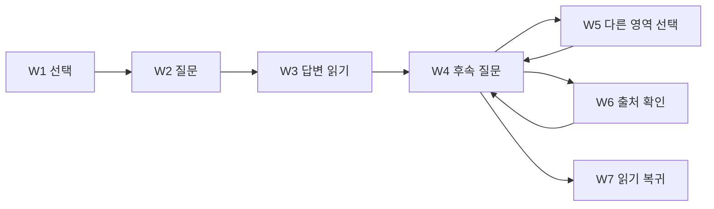

# User Workflow (사용자 흐름) — 초안

> PRD 전에 채우는 공개 템플릿/요약. 승인된 Linear 원본이 우선한다. 고객 원문과 내부 결정은 여기에 복사하지 않는다.

- 원본 참조: Linear MEG-186 「문서 기반 CS 학습 에이전트 — 디자인·사용자 흐름 v0.1」(14절 목업 연결 포함). 사람 확인: 2026-11-03 사용자가 제시한 흐름으로 PRD 작성 진행에 동의(MEG-186)
- 참조 버전/확인일: v0.1 + 14절, 2026-11-04
- 상태: 디자인 검토안 — 대상은 CS 학습 노트의 문서 기반 질문 흐름(CS Agent) 1개다. 목업은 사람 확인 전이며 실제 사용자 관찰·사용성 시험은 없다. 기존 노트 읽기·용어·퀴즈 흐름은 이 문서에 옮기지 않았다(Linear 원본 참조).

## 0. 진행 순서와 시작 조건

| 순서 | 산출물 | 시작 조건 |
|---|---|---|
| 1 | 사용자 흐름 (이 문서) | 검증할 제품 후보 1개가 정해짐 |
| 2 | PRD (`docs/prd.md`) | 이 문서의 1–4절이 채워지고 사람이 흐름을 확인함 |
| 3 | 디자인 (Claude Design) | PRD를 사람이 수락함. Claude Design 가용성을 확인함 |
| 4 | 백엔드 API spec | 이 문서의 2–3절을 사람이 확인하고 PRD를 사람이 수락함. 디자인과 병행할 수 있음 |
| 5 | 기술 검토·구현 | [spec-flow의 '탐색에서 개발로'](harness/spec-flow.md#탐색에서-개발로) 조건을 충족함. 디자인·API spec을 함께 검토함 |

각 산출물은 표의 시작 조건을 충족한 뒤에 작성하며, 디자인과 백엔드 API spec은 병행할 수 있다. 시작 조건이 충족되지 않았으면 해당 단계 섹션을 채우지 않는다. 특히 5절(디자인)은 PRD 수락 전에 비워 둔다.

## 작성 규칙 (AI 에이전트·사람 공통)

- 각 항목 끝에 근거 구분을 붙인다: `[사실]` 관찰·데이터로 확인됨, `[가설]` 우리 추정, `[미확인]` 아직 모름.
- `[사실]`에는 근거 위치(Linear 이슈 ID, 공개 가능한 자료명)를 함께 적는다. 근거 없는 수치·기간·비율을 만들지 않는다.
- 흐름 하나는 사용자 목표 하나를 다룬다. 목표가 둘이면 2절 표를 나눈다.
- 화면 모양이 아니라 사용자 행동과 결과를 적는다. 버튼 배치·색 같은 결정은 5절로 미룬다.
- 고객 발언 원문 대신 익명 요약을 쓴다. 원문은 접근이 제한된 Linear 원본에 둔다.
- Linear 원본과 이 문서가 다르면 원본을 따르고, 차이를 이슈에 기록한 뒤 이 문서를 고친다.

## 1. 대상 사용자와 사용 상황

- 사용자: 노트를 읽는 비전공자 학습자 [가설] (MEG-186)
- 사용 상황 (흐름이 시작되는 계기): 노트를 읽다가 이해가 막히는 용어·문장을 만난다 [가설] (MEG-186)
- 사용자가 이루려는 목표: 노트를 떠나지 않고 개념의 원리·사용 상황·제한을 이해하고, 이어서 질문한 뒤 읽기로 돌아간다 [가설] (MEG-186)
- 지금 쓰는 대안·우회 방법: 선택한 용어의 짧은 AI 설명과 대표 위키 열기 [사실] (현재 제품 동작, MEG-186)
- 근거: 선택 영역 설명이 짧고 부실해 학습 가치가 부족하다는 사용자 피드백이 있다 [사실] (MEG-186, 별도 사용성 시험 결과는 아님). 설명 깊이에 대한 사용자별 선호, 문맥 추출·검색 품질, 대화 사용률과 이해도 향상은 [미확인]이다.

## 2. 핵심 흐름

- 흐름 이름: 문서 옆에서 질문하는 CS Agent 흐름
- 시작 조건: 노트를 읽는 중 용어·문장을 선택한다.
- 끝 조건 (사용자가 목표를 이뤘다고 볼 수 있는 상태): 사용자가 개념의 활용 상황과 핵심 조건을 자기 말로 설명하거나 짧은 적용 문제에 답하고 노트 읽기로 돌아간다. 대화 횟수나 글자 수만으로 성공을 판정하지 않는다. [가설] (MEG-186)

| 단계 | 사용자 행동 | 시스템 반응 | 막히는 지점·감정 | 근거 구분 |
|---|---|---|---|---|
| W1 | 용어·문장을 선택 | 선택 영역을 강조하고 'AI에게 질문'을 제공한다. 선택만으로 모델을 호출하지 않는다 | 무엇을 질문하는지 분명하지 않으면 망설일 수 있음 [미확인] | [가설] MEG-186 |
| W2 | 질문 또는 '자세히 설명'을 요청 | 선택 문맥을 보여 주고 전송할 때만 시작한다. 의미가 모호할 때만 구분 질문한다 | 매번 선행 질문을 받으면 흐름이 끊길 수 있음 [미확인] | [가설] MEG-186 |
| W3 | 답변을 읽음 | 핵심 답, 원리, 구체적 적용 예, 조건, 출처를 보여 준다 | 원문을 바꿔 말하는 수준이면 학습 도움이 부족함 [사실] (사용자 피드백, MEG-186) | [가설] MEG-186 |
| W4 | 추천 질문을 고르거나 직접 입력 | 같은 대화의 후속 답변을 준다. 앞선 설명 전체를 반복하지 않는다 | 문맥을 다시 설명해야 하면 이탈할 수 있음 [미확인] | [가설] MEG-186 |
| W5 | 다른 영역을 선택 | 현재 대화에 추가할지 새 대화로 시작할지 구분해 보여 준다 | 이전 주제가 새 답변에 섞일 수 있음 [미확인] | [가설] MEG-186 |
| W6 | 출처를 확인 | 인용된 문단을 보여 주고 '대화로 돌아가기'를 제공한다 | 출처가 설명과 맞지 않으면 신뢰가 떨어질 수 있음 [미확인] | [가설] MEG-186 |
| W7 | 패널을 닫거나 노트로 돌아감 | 읽던 위치로 복원한다 | 읽던 위치를 잃으면 읽기를 이어가기 어려움 [미확인] | [가설] MEG-186 |

## 3. 예외·이탈 흐름

| 관련 단계 | 발생 조건 | 사용자에게 보이는 결과 | 복구 방법 | 근거 구분 |
|---|---|---|---|---|
| W2 | 선택한 말의 의미가 여러 개(다의어) | 의미를 고르는 짧은 질문. 추측으로 단정하지 않는다 | 후보를 고르거나 직접 보충 | [가설] MEG-186 |
| W3 | 근거가 얇거나 없음 | 설명 가능한 범위와 제한을 한 번 안내한다. 길이를 채우려고 반복하지 않는다 | 질문을 구체화하거나 노트로 복귀 | [가설] MEG-186 |
| W3 | 노트와 근거가 충돌 | 근거가 지지하는 구절만 교정하고 미해결 부분을 분리한다. 노트를 자동으로 고치지 않는다 | 근거를 확인 | [가설] MEG-186 |
| W4 | 학습 문맥과 관련 없는 질문 | 현재 문맥 밖임을 알리고 주제 전환 여부를 확인한다 | 전환하거나 취소 | [가설] MEG-186 |
| W2–W6 | 응답 지연·중단·실패 | 입력과 읽던 위치를 유지하고 중복 전송을 막는다 | 명시적으로 다시 시도 | [가설] MEG-186 |
| W3 | 이미지·다이어그램 표시 실패 | 본문 설명은 계속 읽을 수 있다. 빈 그림 영역을 남기지 않는다 | 텍스트 설명을 읽음 | [가설] MEG-186 |
| W4–W6 | 권한 회수·다른 사용자 세션 | 이전 대화·출처·이미지로 비공개 내용이 새지 않는다 | 접근 가능한 노트로 복귀 | [가설] MEG-186 |
| W2–W6 | AI 요청 제한 | 지금은 AI 답변을 요청할 수 없다고 알린다. 제한 수치는 [미확인] | 원문을 읽고 가능할 때 다시 시도 | [가설] MEG-186 |
| W7 | 모바일·패널 닫기 | 선택 위치와 복귀 경로를 유지한다. 새로고침·로그아웃 뒤 보관 기간은 [미확인] | 노트로 복귀 | [가설] MEG-186 |

## 4. PRD로 넘길 항목

| 흐름 단계 | PRD 섹션 | 넘길 내용 | 근거 구분 |
|---|---|---|---|
| W1–W7 | 1. 한 문장 설명 | 노트를 읽는 비전공자가 선택한 개념을 충분히 이해하고 같은 문맥에서 이어 질문하도록 돕는다 | [가설] MEG-186 |
| W1 | 2. 사용자와 상황 | 노트를 읽다가 막힌 용어·문장을 만난 비전공자 | [가설] MEG-186 |
| W3–W7 | 3. 목표와 성공 확인 (가설·관찰할 행동) | 활용 상황과 핵심 조건을 자기 말로 설명한다. 관찰할 행동: 불필요한 확인 질문, 원문 복사 느낌, 예시의 도움, 문맥 오해, 복귀 실패 | [가설] MEG-186 |
| W1–W7 | 4. 범위 (Must·Later·이번에는 만들지 않음) | Must 후보: 문맥 기반 설명, 대표 위키에서 질문, 추천·직접 질문, 출처와 원문 복귀, 대화 문맥 경계. Later 후보: 외부 웹 검색, 장기 대화 보관, 개인화·공유. 이번에는 만들지 않음: 노트 자동 수정·공개, 범용 업무 자동화, 파인튜닝, 무제한 대화 | [가설] MEG-186 |
| W3–W7 | 5. 사용자 스토리·완료 조건 | 단계별 완료 조건은 Linear의 수락된 PRD를 따른다(공개 요약을 두지 않는다) | [사실] MEG-186 |
| W2–W7 | 6. 비기능·열린 질문 | 개발 담당자, 대화 보관·상한, 실험 대상·기간은 [미확인]. 권한은 질문마다 유지해야 한다 | [미확인] MEG-186 |

PRD를 쓰는 에이전트는 이 표를 입력으로 사용하고, 표에 없는 문제나 가설을 PRD에 추가하면 그 출처를 따로 적는다.

## 5. 디자인 단계 연결 (PRD 수락 후 작성)

- PRD 수락 기록 (Linear 이슈·결정일): MEG-186, 2026-11-04 사용자 수락
- Claude Design 가용성 확인 (확인일·결과): 2026-11-04, Claude Code에서 비공개 Design 캔버스에 화면을 게시·수정함. 사용 가능
- 대체 방법 (사용할 수 없을 때): 와이어프레임으로 검토
- 디자인 입력: 이 문서 2·3절, PRD 범위·비목표
- 프로토타입 링크·버전: 비공개 Design 캔버스 「CS 학습 노트 목업 v0.2」 Version 32, 보드 F6-0~F6-10. 링크는 접근이 제한된 원본(MEG-186 문서 14절)에 있다. 클릭 이동이 되는 화면 초안이며 사람 확인 전이고, 무과금 시나리오 검증(UX01~UX12)은 하지 않았다
- 흐름 단계 ↔ 화면 대응:

| 흐름 단계 | 화면·상태 | 프로토타입 위치 |
|---|---|---|
| W1 | 노트 읽기·문장 선택 | F6-0(PC), F6-0m(모바일) |
| W2 | 질문 준비, 답변 준비 중 | F6-1, F6-2 (PC) |
| W3 | 정상 답변 | F6-3(PC), F6-5(모바일) |
| W4 | 후속 답변 | F6-7(PC) |
| W5 | 다른 영역 선택 | F6-8(PC) |
| W6 | 출처 보기 | F6-4(PC), F6-9(모바일) |
| W7 | 닫기·읽기 복귀 | 닫기 → F6-0, F6-0m (목업 이동용) |
| 3절 예외 | 요청 실패 | F6-6(모바일) |
| 3절 예외 | 긴 답변 스크롤 | F6-10(PC) |

- 아직 그리지 않은 것: 모바일의 질문 준비·준비 중·후속 답변·다른 영역 선택, PC의 요청 실패, 의미 확인, 부분·근거 없음, 교정, 중단, 접근 변경, 그림 표시 실패, AI 요청 제한, 이미지·다이어그램 자리.
- 사람 결정 대기: ① 기존 단어 선택의 'AI 설명'(단발 설명)과 'AI에게 질문'의 관계(대체인지 병존인지), ② 출처 종류(읽던 노트 문단인지 내부 위키 문단인지), ③ 목업의 '오류 신고' 버튼을 이 흐름의 범위에 넣을지.
- 목업에서 바뀐 점: 패널 이름을 'CS Agent'로 쓴다. 보내기·돌아가기·중단 버튼은 아이콘 전용이며 디자인 시스템 Button 규칙의 예외다(aria-label 필수, 디자인 시스템 갱신 전). 선택 문맥 칩의 '빼기'는 '제외'로 바꿨다.

## 6. 단계별 점검

- [x] 1–3절의 모든 항목에 근거 구분이 붙어 있다.
- [x] `[사실]` 항목마다 근거 위치가 있다.
- [x] 4절 표가 PRD 1–6절에 대응한다.
- [x] 사람이 흐름을 확인한 기록(Linear 이슈·일자)이 원본 참조에 있다.
- [x] 5절은 PRD 수락 기록이 생긴 뒤에만 채워졌다.

## 변경 이력
- 2026-10-20: 템플릿 생성 (MEG-32)
- 2026-10-20: 0절에 백엔드 API spec 단계 추가 (MEG-36)
- 2026-10-21: 4절 표·6절 점검을 PRD 6절 구조에 맞춤 (MEG-37)
- 2026-11-04: 문서 기반 질문 흐름(CS Agent)과 목업 연결을 반영 (MEG-186)
