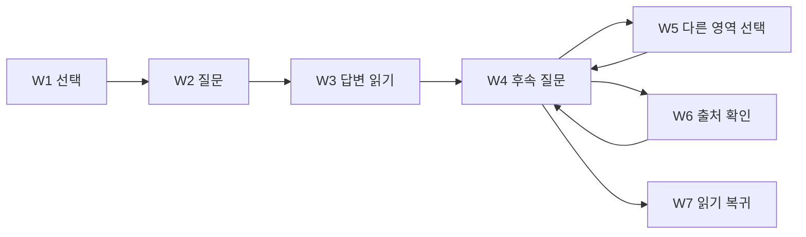

# User Workflow (사용자 흐름) — CS 학습 노트 전체

> PRD 전에 채우는 공개 템플릿/요약. 승인된 Linear 원본이 우선한다. 고객 원문과 내부 결정은 여기에 복사하지 않는다.

- 문서 버전: v0.4 (2026-11-05). 변경 이력은 맨 아래 표
- 원본 참조: Linear 「CS 학습 노트 PRD v0.6」, 「CS 학습 노트 사용자 흐름 v0.1」, 「퀴즈 단일 문항·선택 저장·재풀이 사용자 흐름 v0.1」(MEG-160), MEG-186 「문서 기반 CS 학습 에이전트 — 디자인·사용자 흐름 v0.2」. 링크는 접근이 제한된 원본에 있다.
- 참조 버전/확인일: PRD v0.6 · 2026-11-05. PRD 1~3절(AC-1~AC-10)은 v0.5 기준으로 2026-10-21 사람이 수락했다(MEG-27). v0.6이 더한 퀴즈 범위(범위 9)와 AC-11~AC-14 문장, PC 화면 범위(범위 10)와 AC-15~AC-17 문장은 2026-11-05 사람이 수락했다. 실행 확인은 모두 남아 있다.
- 상태: 제품 전체(방문자·사용자·운영자)의 흐름을 글로 정리한 공개 요약이다. 화면 디자인은 별도 캔버스에 있고 5절에 짧게 연결했다. 사람이 흐름 전체를 이 버전으로 확인한 기록은 아직 없다. 실제 사용자 관찰은 없다(PRD 1절).

## 0. 진행 순서와 시작 조건

| 순서 | 산출물 | 시작 조건 |
|---|---|---|
| 1 | 사용자 흐름 (이 문서) | 검증할 제품 후보 1개가 정해짐 |
| 2 | PRD (`docs/prd.md`) | 이 문서의 1–4절이 채워지고 사람이 흐름을 확인함 |
| 3 | 디자인 (Claude Design) | PRD를 사람이 수락함. Claude Design 가용성을 확인함 |
| 4 | 백엔드 API spec | 이 문서의 2–3절을 사람이 확인하고 PRD를 사람이 수락함. 디자인과 병행할 수 있음 |
| 5 | 기술 검토·구현 | [spec-flow의 '탐색에서 개발로'](harness/spec-flow.md#탐색에서-개발로) 조건을 충족함. 디자인·API spec을 함께 검토함 |

각 산출물은 표의 시작 조건을 충족한 뒤에 작성하며, 디자인과 백엔드 API spec은 병행할 수 있다. 시작 조건이 충족되지 않았으면 해당 단계 섹션을 채우지 않는다. 특히 5절(디자인)은 PRD 수락 전에 비워 둔다.

## 작성 규칙 (AI 에이전트·사람 공통)

- 각 항목 끝에 근거 구분을 붙인다: `[사실]` 관찰·데이터로 확인됨, `[가설]` 우리 추정, `[미확인]` 아직 모름.
- `[사실]`에는 근거 위치(Linear 이슈 ID, 공개 가능한 자료명)를 함께 적는다. 근거 없는 수치·기간·비율을 만들지 않는다.
- 흐름 하나는 사용자 목표 하나를 다룬다. 목표가 둘이면 2절 표를 나눈다.
- 화면 모양이 아니라 사용자 행동과 결과를 적는다. 버튼 배치·색 같은 결정은 5절로 미룬다.
- 고객 발언 원문 대신 익명 요약을 쓴다. 원문은 접근이 제한된 Linear 원본에 둔다.
- Linear 원본과 이 문서가 다르면 원본을 따르고, 차이를 이슈에 기록한 뒤 이 문서를 고친다.

## 1. 대상 사용자와 사용 상황

- 사용자: 수업을 듣는 주니어 개발자·PM·SA 중 수업 외에 CS를 따로 공부하는 사람. 첫 로그인 사용자는 운영자가 계정을 발급한 3~4명이다. [사실] (PRD 1·8절, 2026-10-20 결정)
- 방문자: 로그인하지 않고 노트와 용어 사전 설명을 읽는 사람이다. 즐겨찾기·AI 질문·퀴즈는 로그인해야 쓴다. [사실] (PRD 2절 범위 1)
- 운영자: 노트와 용어 사전을 채우고, 계정을 발급하고, 신고를 처리하는 한 명이다. [사실] (PRD 8절)
- 사용 상황: 노트를 읽다가 모르는 용어를 만날 때, 그리고 헷갈린 용어를 다시 볼 계기가 필요할 때. [가설] (PRD 1절)
- 사용자가 이루려는 목표: 노트를 막힘 없이 읽고, 헷갈린 용어를 다음 날 퀴즈로 복습한다. [가설] (PRD 1절)
- 지금 쓰는 대안·우회 방법: Notion·블로그·검색. 다음 날 퀴즈를 풀러 다시 올지도 확인하지 않았다. [미확인] (PRD 1절 반례)
- 근거:
  - 운영자의 Notion 학습 노트가 실제로 있다. [사실] (MEG-27, 2026-10-19 확인)
  - 고객 인터뷰와 사용 데이터는 없다. 내부 아이디어이고 PMF 실험은 생략했다. [사실] (PRD 1절)
  - 10문항을 한꺼번에 보여 주는 퀴즈가 부담스럽다는 사용자 피드백이 한 건 있다. [사실] (MEG-160)
  - 한 문제씩 보여 주면 부담이 줄고 복습이 늘어난다는 효과는 검증하지 않았다. [미확인]
  - 선택 영역의 AI 설명이 짧고 부실해 학습 가치가 부족하다는 사용자 피드백이 있다. 별도 사용성 시험 결과는 아니다. [사실] (MEG-186)

문서 옆에서 질문하는 흐름(F6)의 사용자와 상황은 다음과 같이 따로 적는다.

- 사용자: 노트를 읽는 비전공자 학습자 [가설] (MEG-186)
- 사용 상황 (흐름이 시작되는 계기): 노트를 읽다가 이해가 막히는 용어·문장을 만난다 [가설] (MEG-186)
- 사용자가 이루려는 목표: 노트를 떠나지 않고 개념의 원리·사용 상황·제한을 이해하고, 이어서 질문한 뒤 읽기로 돌아간다 [가설] (MEG-186)
- 지금 쓰는 대안·우회 방법: 선택한 용어의 짧은 AI 설명과 대표 위키 열기 [사실] (현재 제품 동작, MEG-186)
- 설명 깊이에 대한 사용자별 선호, 문맥 추출·검색 품질, 대화 사용률과 이해도 향상은 [미확인]이다. (MEG-186)

## 2. 핵심 흐름

흐름 여덟 개를 다룬다. 방문자·사용자 흐름(F1~F3, F6), 퀴즈 두 흐름(Q1·Q2), 운영자 흐름(F4·F5)이다. F1~F5 번호는 Linear 사용자 흐름 원본과 같다.

모바일과 PC(Windows 브라우저)에서 흐름은 같다. PC 화면은 MVP 범위에 들어간다(PRD 범위 10, AC-15~AC-17). [사실] (2026-11-05 사람 수락) 흐름·권한·저장 데이터는 모바일과 같고 배치만 다르다. PC 폭은 1024px 이상이고 그 미만은 모바일 배치를 쓴다. 헤더 '퀴즈' 메뉴, '이어서 풀기' 버튼, 풀이 화면의 왼쪽 문제 목록은 범위에 넣지 않는다. [사실] (PRD 2.2절) 로그인한 사용자는 PC 목록 화면의 '오늘의 퀴즈'로 퀴즈에 들어간다. [가설] (AI 제안, 사람 확인 전) 실제 Edge·Chrome 확인은 하지 않았다. [미확인]

### F1. 노트를 읽다가 용어 설명을 본다 (방문자·사용자 모두, 로그인 불필요)

- 시작 조건: 배포 URL에 접속한다.
- 끝 조건: 용어 설명을 보고 노트로 돌아와 읽기를 이어 간다.

| 단계 | 사용자 행동 | 시스템 반응 | 막히는 지점·감정 | 근거 구분 |
|---|---|---|---|---|
| 1 | 과목을 고른다 | 그 과목의 노트 목록을 보여 준다 | 원하는 노트를 찾기 어려울 수 있다 | 반응 [사실] (PRD 범위 2), 막힘 [가설] |
| 2 | 노트를 연다 | 본문을 보여 준다. 사전에 있는 용어는 링크로 표시한다 | 링크 표시를 알아보지 못할 수 있다 | 반응 [사실] (PRD 범위 3, AC-4), 막힘 [가설] |
| 3 | 링크된 용어를 누른다 | 사전 설명(글·이미지)을 시트로 보여 준다. 로그인한 사용자는 열람 기록이 남는다 | 설명이 부족하면 어디서 더 보는지 모른다 | 반응 [사실] (PRD 범위 7, AC-4), 막힘 [미확인] |
| 4 | 시트를 닫고 읽기를 이어 간다 | 노트의 읽던 위치로 돌아온다 | 읽던 위치를 잃을 수 있다 | [가설] |

시트의 "전체 보기"(전체 화면으로 열기)는 사용자 요청이 있었지만 개발 범위에 넣을지 정하지 않았다. [미확인] (Linear 사용자 흐름 원본 4절, MEG-76)

### F2. 사전에 없는 말을 AI에게 묻는다 (로그인 필요)

PRD v0.6은 이 흐름을 "AI 설명"(드래그로 선택 → 짧은 AI 설명)으로 적고 있다. 2026-11-04 사용자 결정(MEG-186)으로 'AI 설명'은 'AI에게 질문'(F6)으로 대체한다. 이 결정은 PRD에 반영하지 않았다. [미확인] 아래 표는 PRD v0.6 기준이며, 대체 후의 흐름은 F6이다.

| 단계 | 사용자 행동 | 시스템 반응 | 막히는 지점·감정 | 근거 구분 |
|---|---|---|---|---|
| 1 | 사전에 링크가 없는 단어를 드래그로 선택한다 | 설명을 요청하는 동작을 보여 준다 | 드래그할 수 있다는 것을 모를 수 있다 | 반응 [사실] (PRD 8절 2026-10-21), 막힘 [가설] |
| 2a | (로그인 상태) 요청한다 | "AI 생성" 표시가 붙은 설명을 보여 준다 | AI 설명을 믿어도 되는지 불안할 수 있다 | 반응 [사실] (AC-5), 감정 [가설] |
| 2b | (비로그인 상태) 요청한다 | 로그인을 안내하고 AI를 호출하지 않는다 | 계정이 없으면 막힌다 | 반응 [사실] (AC-5), 막힘 [가설] |
| 3 | 설명이 틀렸다고 보고 "오류 신고"를 누른다 | 신고가 운영자 신고 목록에 쌓인다 | 신고 뒤에 무슨 일이 있는지 모른다 | 반응 [사실] (AC-6), 막힘 [미확인] |

### F3. 열어 본 용어를 다음 날 퀴즈로 복습한다 (로그인 필요)

- 시작 조건: 로그인한 사용자가 용어를 열어 보거나 즐겨찾기했다.
- 끝 조건: 다음 날 퀴즈의 문항과 꼬리 질문에 답한다.

| 단계 | 사용자 행동 | 시스템 반응 | 막히는 지점·감정 | 근거 구분 |
|---|---|---|---|---|
| 1 | (당일) 시트로 용어를 열어 본다 | 열람 기록을 남긴다 | 기록이 남는 것을 모를 수 있다 | 반응 [사실] (PRD 범위 7), 막힘 [가설] |
| 2 | 헷갈린 용어를 즐겨찾기한다 | 저장하고 새로고침 뒤에도 유지한다. 다른 사용자에게는 보이지 않는다 | 즐겨찾기를 모아 보는 화면은 이번에 없다 | 반응 [사실] (AC-7, 비목표), 막힘 [가설] |
| 3 | (다음 날 08:30 한국 시간 이후) 접속한다 | 전날 열어 본·즐겨찾기한 용어로 만든 퀴즈를 보여 준다. 08:30 전에는 보이지 않는다 | 퀴즈가 있는 줄 모르고 지나칠 수 있다 | 반응 [사실] (AC-8), 막힘 [가설] |
| 4 | 문항에 답한다 | AI가 판단한 난이도(상·중·하)를 표시하고, 답한 뒤 정답·해설을 보여 준다 | 정답·해설을 답한 뒤에 보여 주는 것은 수락에 포함된 가정이다 | 반응 [사실] (AC-8, PRD 9절), 막힘 [미확인] |
| 5 | 꼬리 질문에 답한다 (문항당 최대 2개) | 답변을 바탕으로 면접처럼 더 묻는다. 맞음·틀림을 채점하지 않는다 | 맞는지 알 수 없어 답답할 수 있다 | 반응 [사실] (PRD 8절 2026-10-21), 감정 [가설] |
| 6 | 퀴즈가 틀렸다고 보고 "오류 신고"를 누른다 | 신고가 운영자 신고 목록에 쌓인다 | F2 3단계와 같다 | 반응 [사실] (AC-6) |

같은 문항은 이틀 연속 나오지 않는다. 대상 용어가 없으면 퀴즈가 없다고 안내한다. [사실] (AC-8)

### Q1. 오늘의 퀴즈를 한 문제씩 푼다 (로그인 필요)

PRD v0.6이 MVP에 더한 흐름이다(범위 9, 2.1절). 위 F3의 3~5단계를 "한 번에 한 문항"으로 바꾼다.

- 시작 조건: 로그인한 사용자가 오늘의 퀴즈를 연다.
- 끝 조건: 원하는 만큼 풀고 목록에서 진행 상태를 확인한다.

| 단계 | 사용자 행동 | 시스템 반응 | 막히는 지점·감정 | 근거 구분 |
|---|---|---|---|---|
| Q1-1 | 오늘의 퀴즈를 연다 | 현재 문제 하나와 진행 상태를 보여 준다 | 몇 문제가 남았는지 모르면 부담스러울 수 있다 | 한 문항 표시 [사실] (PRD 범위 9, AC-11), 진행 표시 방식 [가설], 막힘 [가설] |
| Q1-2 | 답한다 | 최초 답을 제출하고 정답·해설을 보여 준다. 꼬리 질문은 F3 5단계와 같다. 같은 문항에 다시 제출하면 거부하고 첫 답을 지킨다 | — | [사실] (AC-8, AC-11, MEG-92) |
| Q1-3 | 다음 문제로 이동한다 | 다음 한 문항을 보여 준다. 답하지 않고 넘어갈 수도 있다 | 건너뛴 문제를 잊을 수 있다 | 이동 [사실] (AC-11), 건너뛰기·이전 문제 이동 [가설], 막힘 [가설] |
| Q1-4 | 문제 목록을 본다 | 오늘 문제의 목록과 답함·저장 상태를 보여 준다 | — | [사실] (AC-11) |

### Q2. 원하는 문제를 저장하고 다시 푼다 (로그인 필요)

- 시작 조건: 로그인한 사용자가 자기 문제 목록을 연다.
- 끝 조건: 저장한 문제를 나중에 다시 풀고 정답·해설을 확인한다.

| 단계 | 사용자 행동 | 시스템 반응 | 막히는 지점·감정 | 근거 구분 |
|---|---|---|---|---|
| Q2-1 | 목록에서 문제를 저장한다 | 자기 계정에 그 문항을 저장하고 성공 상태를 보여 준다. 같은 문항은 중복 저장하지 않는다 | 용어 즐겨찾기와 헷갈릴 수 있다 | 저장 [사실] (AC-12), 중복 방지 [가설] (PRD 2.1절 검토안), 막힘 [가설] |
| Q2-2 | 저장한 문제 목록을 연다 | 저장한 문제만 최근 저장 순으로 보여 준다 | — | 목록 [사실] (AC-12), 정렬 [사실] (2026-11-05 결정, MEG-182·MEG-207) |
| Q2-3 | 문제를 골라 다시 푼다 | 선택한 기존 문제 하나를 보여 준다. AI로 문제를 다시 만들지 않는다 | — | [사실] (AC-13, 2026-11-03 정책) |
| Q2-4 | 답을 쓰고 확인한다 | 정답·해설과 비교해 보여 준다. 처음 낸 답은 그대로 두고, 이번 답은 저장하지 않는다. 새 꼬리 질문은 없다 | 이탈하면 이번 답이 사라진다 | 정책 [사실] (2026-11-03), 확인 뒤 공개 [가설] |
| Q2-5 | 저장을 해제한다 | 저장 목록에서 뺀다. 원본 문제와 최초 답안은 지우지 않는다 | — | [사실] (AC-14) |

용어 즐겨찾기는 다음 날 출제 후보인 용어를 다루고, 문제 저장은 이미 만들어진 문항을 보관한다. 두 동작은 서로를 바꾸지 않는다. [사실] (AC-12)

### F4. 운영자가 초기 설정을 한다 (1회)

- 시작 조건: 운영자 계정이 DB에 등록되어 있다.
- 끝 조건: 노트가 들어 있고 사용자 계정이 발급되어 있다.

| 단계 | 사용자 행동 | 시스템 반응 | 막히는 지점·감정 | 근거 구분 |
|---|---|---|---|---|
| 1 | 운영자 계정으로 로그인한다 | 운영자 기능이 보인다 | — | [사실] (AC-1) |
| 2 | Notion 가져오기 명령을 실행한다 | 체크한 노트가 과목별 목록에 들어온다. 다시 실행해도 중복이 없고 강의 자료 노트는 제외한다 | 결과가 맞는지 확인할 방법이 필요하다 | 반응 [사실] (AC-3), 막힘 [가설] |
| 3 | 일반 사용자 계정을 발급하고 로그인 정보를 전달한다 | 그 계정으로 로그인할 수 있다 | 로그인 정보를 전달하는 방법을 정하지 않았다 | 반응 [사실] (AC-2), 막힘 [미확인] |

### F5. 운영자가 콘텐츠를 운영하고 신고를 처리한다

- 시작 조건: 운영자로 로그인했다.
- 끝 조건: 노트·사전이 갱신되고 신고가 처리된다.

| 단계 | 사용자 행동 | 시스템 반응 | 막히는 지점·감정 | 근거 구분 |
|---|---|---|---|---|
| 1 | 노트와 용어 사전(설명 글·이미지)을 작성·수정·삭제한다 | 일반 사용자와 방문자에게는 이 기능이 보이지 않고 API도 거부한다 | 사전 용어를 노트 링크와 연결하는 방법이 필요하다 | 반응 [사실] (AC-1), 막힘 [미확인] |
| 2 | 신고 목록을 확인한다 | AI 설명·AI 퀴즈 신고가 쌓여 있다 | — | [사실] (AC-6) |
| 3 | 사전에 바른 설명을 넣는다 | 이후 그 용어는 사전 설명이 우선한다 | 신고한 사용자에게 알리는 방법을 정하지 않았다 | 반응 [사실] (PRD 8절 2026-10-21), 막힘 [미확인] |

### F6. 문서 옆에서 질문하는 CS Agent 흐름 (로그인 필요)

F2의 'AI 설명'을 대체하는 흐름이다(MEG-186 2026-11-04 결정). 아래는 MEG-186 원본을 옮긴 것이며 PRD v0.6에는 아직 없다. [미확인]

- 시작 조건: 노트를 읽는 중 용어·문장을 선택한다.
- 끝 조건 (사용자가 목표를 이뤘다고 볼 수 있는 상태): 사용자가 개념의 활용 상황과 핵심 조건을 자기 말로 설명하거나 짧은 적용 문제에 답하고 노트 읽기로 돌아간다. 대화 횟수나 글자 수만으로 성공을 판정하지 않는다. [가설] (MEG-186)

| 단계 | 사용자 행동 | 시스템 반응 | 막히는 지점·감정 | 근거 구분 |
|---|---|---|---|---|
| W1 | 용어·문장을 선택 | 선택 영역을 강조하고 'AI에게 질문'을 제공한다. 선택만으로 모델을 호출하지 않는다 | 무엇을 질문하는지 분명하지 않으면 망설일 수 있음 [미확인] | [가설] MEG-186 |
| W2 | 질문 또는 '자세히 설명'을 요청 | 선택 문맥을 보여 주고 전송할 때만 시작한다. 의미가 모호할 때만 구분 질문한다 | 매번 선행 질문을 받으면 흐름이 끊길 수 있음 [미확인] | [가설] MEG-186 |
| W3 | 답변을 읽음 | 핵심 답, 원리, 구체적 적용 예, 조건, 출처를 보여 준다 | 원문을 바꿔 말하는 수준이면 학습 도움이 부족함 [사실] (사용자 피드백, MEG-186) | [가설] MEG-186 |
| W4 | 추천 질문을 고르거나 직접 입력 | 같은 대화의 후속 답변을 준다. 앞선 설명 전체를 반복하지 않는다 | 문맥을 다시 설명해야 하면 이탈할 수 있음 [미확인] | [가설] MEG-186 |
| W5 | 다른 영역을 선택 | 현재 대화에 추가할지 새 대화로 시작할지 구분해 보여 준다 | 이전 주제가 새 답변에 섞일 수 있음 [미확인] | [가설] MEG-186 |
| W6 | 출처를 확인 | 인용된 문단을 보여 주고 '대화로 돌아가기'를 제공한다 | 출처가 설명과 맞지 않으면 신뢰가 떨어질 수 있음 [미확인] | [가설] MEG-186 |
| W7 | 패널을 닫거나 노트로 돌아감 | 읽던 위치로 복원한다 | 읽던 위치를 잃으면 읽기를 이어가기 어려움 [미확인] | [가설] MEG-186 |

## 3. 예외·이탈 흐름

### 공통과 노트·용어·운영 (F1~F5)

| 관련 단계 | 발생 조건 | 사용자에게 보이는 결과 | 복구 방법 | 근거 구분 |
|---|---|---|---|---|
| F2·F3·Q1·Q2 | 비로그인 방문자가 AI 질문·즐겨찾기·퀴즈·문제 저장을 누른다 | 로그인 안내. AI는 호출하지 않는다 | 로그인 | [사실] (AC-2, AC-5) |
| F3 2 | 로그인 사용자의 즐겨찾기 저장이 실패한다 (로그인 필요 응답 외 오류) | 실패 안내를 보이고 즐겨찾기 상태는 그대로다. 요청 중에는 버튼을 막아 중복 요청을 거른다 | 다시 누른다 | [사실] (MEG-90 결정 2026-10-30) |
| F3 3 | 08:30 이전에 접속한다 | 퀴즈가 보이지 않는다. 별도 안내 화면은 두지 않는다 | 08:30 이후 접속 | [사실] (AC-8) |
| F3 3 | 전날 열어 본·즐겨찾기한 용어가 없다 | 퀴즈가 없다는 안내 | 용어를 열어 본 뒤 다음 날 접속 | [사실] (AC-8) |
| F3 3 | 08:30이 지났는데 퀴즈 생성이 끝나지 않았다 | 기존 퀴즈 상태(생성 중·실패·AI 한도) 안내를 유지한다. 문구는 정하지 않았다 | 정해지지 않음 | 상태 유지 [사실] (AC-11), 문구 [미확인] |
| F4·F5 | 일반 사용자·방문자가 운영자 기능에 접근한다 | 기능이 보이지 않고 API가 거부한다 | — | [사실] (AC-1) |
| F4 2 | 가져오기를 다시 실행한다 | 중복 노트가 생기지 않는다 | — | [사실] (AC-3) |
| F2 | AI 호출이 실패하거나 오래 걸리거나 비용 한도에 걸린다 | 정해지지 않음 (F6은 아래 표) | 정해지지 않음 | [미확인] (PRD에 없음) |
| F2·F3 | 신고한 뒤 | 신고자에게 무엇이 보이는지 정해지지 않음 | — | [미확인] (PRD에 없음) |
| F1 | 운영자가 아직 공개하지 않은 노트가 있다 | 기술 검토 문서는 공개 여부를 운영자가 고르는 구조를 가정하지만 PRD 범위에는 없다 | — | [미확인] (PRD와 기술 검토 문서가 다름) |
| 로그인 | 로그인에 실패하거나 계정이 비활성이다 | 정해지지 않음 | 정해지지 않음 | [미확인] (PRD에 없음) |

### 퀴즈 한 문제씩·저장·재풀이 (Q1·Q2)

| 관련 단계 | 발생 조건 | 사용자에게 보이는 결과 | 복구 방법 | 근거 구분 |
|---|---|---|---|---|
| Q1 | 오늘 퀴즈가 아직 열리지 않았거나 없거나 생성 중이거나 실패했거나 AI 한도에 걸렸다 | 기존 퀴즈 상태 안내를 그대로 쓴다 | 상태에 따라 다시 접속 | [사실] (AC-11, MEG-207) |
| Q1-2 | 이미 답한 문항에 다시 제출하거나 남의 문항에 제출한다 | 첫 답을 지키고 거부한다. 각각 다른 안내를 보인다 | — | [사실] (MEG-92, MEG-109) |
| Q1-2 | 답 제출이 실패한다 | 쓴 답을 남기고 다시 제출하게 한다 | 다시 제출 | [가설] |
| Q1 | 오늘 퀴즈를 풀다가 나갔다가 다시 접속한다 | 답한 문항의 답·정답·해설과 받은 꼬리 질문을 복원한다. 쓰다 만 입력은 보존하지 않는다. 꼬리 질문에 쓴 답 원문은 복원하지 않는다 | — | [사실] (AC-11, MEG-207) |
| Q1·Q2 | 제출·저장·해제 중에 같은 버튼을 다시 누른다 | 중복 저장과 답 덮어쓰기를 막는다 | — | [사실] (AC-14) |
| Q2-1·Q2-5 | 저장·해제가 실패한다 | 기존 상태를 유지하고 실패를 안내한다. 성공으로 표시하지 않는다 | 다시 시도 | [사실] (AC-14) |
| Q2-2 | 저장한 문제가 없다 | 저장한 문제가 없다는 안내와 오늘 목록으로 이동 | 오늘 목록에서 저장 | [가설] (추가 흐름 v0.1 3절 디자인 제안) |
| Q2-3 | 저장한 문제의 원본이 바뀌었거나 지워졌다 | 원인을 추측하지 않고 안내한다. 저장 해제만 허용하고 다시 풀기는 막는다 | 저장 해제 또는 목록으로 | 처리 [사실] (2026-11-05 결정, MEG-182·MEG-207), 안내 문구 [가설] |
| Q2-3 | 다시 푸는 중에 나갔다 | 이번 답은 지워진다. 처음 낸 답은 그대로다. 이탈 복원은 MVP에서 뺀다 | 다시 풀기 | [사실] (2026-11-05 결정, MEG-182·MEG-207) |
| Q2 | 비로그인이나 다른 계정이 저장 목록·저장·해제·재풀이에 접근한다 | 접근을 거부한다 | 로그인 | [사실] (AC-14) |
| Q2-3 | 한 번도 답하지 않고 저장한 문제를 다시 푼다 | 그 답을 처음 낸 답으로 남길지 정하지 않았다 | 정해지지 않음 | [미확인] |

### CS Agent (F6)

| 관련 단계 | 발생 조건 | 사용자에게 보이는 결과 | 복구 방법 | 근거 구분 |
|---|---|---|---|---|
| W2 | 선택한 말의 의미가 여러 개(다의어) | 의미를 고르는 짧은 질문. 추측으로 단정하지 않는다 | 후보를 고르거나 직접 보충 | [가설] MEG-186 |
| W3 | 근거가 얇거나 없음 | 설명 가능한 범위와 제한을 한 번 안내한다. 길이를 채우려고 반복하지 않는다 | 질문을 구체화하거나 노트로 복귀 | [가설] MEG-186 |
| W3 | 노트와 근거가 충돌 | 근거가 지지하는 구절만 교정하고 미해결 부분을 분리한다. 노트를 자동으로 고치지 않는다 | 근거를 확인 | [가설] MEG-186 |
| W4 | 학습 문맥과 관련 없는 질문 | 현재 문맥 밖임을 알리고 주제 전환 여부를 확인한다 | 전환하거나 취소 | [가설] MEG-186 |
| W2–W6 | 응답 지연·중단·실패 | 입력과 읽던 위치를 유지하고 중복 전송을 막는다 | 명시적으로 다시 시도 | [가설] MEG-186 |
| W3 | 이미지·다이어그램 표시 실패 | 본문 설명은 계속 읽을 수 있다. 빈 그림 영역을 남기지 않는다 | 텍스트 설명을 읽음 | [가설] MEG-186 |
| W4–W6 | 권한 회수·다른 사용자 세션 | 이전 대화·출처·이미지로 비공개 내용이 새지 않는다 | 접근 가능한 노트로 복귀 | [가설] MEG-186 |
| W2–W6 | AI 요청 제한 | 지금은 AI 답변을 요청할 수 없다고 알린다. 제한 수치는 [미확인] | 원문을 읽고 가능할 때 다시 시도 | [가설] MEG-186 |
| W7 | 모바일·패널 닫기 | 선택 위치와 복귀 경로를 유지한다. 새로고침·로그아웃 뒤 보관 기간은 [미확인] | 노트로 복귀 | [가설] MEG-186 |

## 4. PRD로 넘길 항목

### PRD v0.6과의 대응

PRD가 이미 있으므로, 이 표는 흐름과 PRD의 연결을 확인하고 PRD에 없는 항목을 드러내는 용도다.

| 흐름 | PRD v0.6에서 대응하는 곳 | 상태 | 근거 구분 |
|---|---|---|---|
| F1 | 2절 범위 2·3, AC-2·AC-4 | 대응함 | [사실] |
| F2 | 2절 범위 4·5, AC-5·AC-6 | 대응함. 단 'AI 설명'을 'AI에게 질문'으로 바꾼 결정(MEG-186)은 반영 전 | [사실] [미확인] |
| F3 | 2절 범위 6·7, AC-7·AC-8·AC-6 | 대응함 | [사실] |
| Q1·Q2 | 2절 범위 9·10, 2.1절·2.2절, AC-11~AC-17 | 대응함. AC-11~AC-14 문장과 PC 범위·AC-15~AC-17은 2026-11-05 수락했다. 실행 확인은 남아 있다. 결정은 PRD 8절에 기록했다 | [사실] [미확인] |
| F4 | 2절 범위 1·2, AC-1·AC-2·AC-3 | 대응함 | [사실] |
| F5 | 2절 범위 2·3·5, AC-1·AC-6 | 대응함 | [사실] |
| F6 | 없음 | PRD 반영 전. 아래 표가 입력이다 | [미확인] |
| 배포·키 비커밋 | AC-9·AC-10 | 흐름과 무관한 비기능 | [사실] |

### PRD에 추가할지 정할 열린 질문

1. 노트를 운영자가 공개로 고르는 단계가 필요한가. [미확인]
2. AI 호출 실패·한도 초과 때 사용자에게 무엇을 보여 주는가. [미확인]
3. 퀴즈가 아직 만들어지지 않았거나 중간에 이탈한 경우의 문구. [미확인]
4. 신고 뒤 신고자에게 무엇이 보이는가. [미확인]
5. 로그인 실패·비활성 계정. [미확인]
6. 시트의 "전체 보기"를 범위에 넣는가. [미확인]
7. 한 번도 답하지 않고 저장한 문제를 다시 풀 때 그 답을 처음 낸 답으로 남기는가. [미확인]
8. PC(Windows 브라우저) 화면은 MVP에 넣기로 정했고 PRD 범위 10과 AC-15~AC-17에 반영했다. [사실] (2026-11-05 사람 수락) 남은 일: 아직 그리지 않은 PC 상태 화면(저장 중·실패·빈 목록 등)을 정하고, 제품 화면이 생긴 뒤 Edge·Chrome·키보드 확인(AC-16, AC-17)을 한다. [미확인]
9. 'AI에게 질문'(F6)의 PRD 반영과 개발 담당자. [미확인] (MEG-186)

### F6을 PRD로 넘기는 입력

| 흐름 단계 | PRD 섹션 | 넘길 내용 | 근거 구분 |
|---|---|---|---|
| W1–W7 | 1. 한 문장 설명 | 노트를 읽는 비전공자가 선택한 개념을 충분히 이해하고 같은 문맥에서 이어 질문하도록 돕는다 | [가설] MEG-186 |
| W1 | 2. 사용자와 상황 | 노트를 읽다가 막힌 용어·문장을 만난 비전공자 | [가설] MEG-186 |
| W3–W7 | 3. 목표와 성공 확인 (가설·관찰할 행동) | 활용 상황과 핵심 조건을 자기 말로 설명한다. 관찰할 행동: 불필요한 확인 질문, 원문 복사 느낌, 예시의 도움, 문맥 오해, 복귀 실패 | [가설] MEG-186 |
| W1–W7 | 4. 범위 (Must·Later·이번에는 만들지 않음) | Must 후보: 문맥 기반 설명, 대표 위키에서 질문, 추천·직접 질문, 출처와 원문 복귀, 대화 문맥 경계. Later 후보: 외부 웹 검색, 장기 대화 보관, 개인화·공유. 이번에는 만들지 않음: 노트 자동 수정·공개, 범용 업무 자동화, 파인튜닝, 무제한 대화 | [가설] MEG-186 |
| W3–W7 | 5. 사용자 스토리·완료 조건 | 단계별 완료 조건은 Linear의 수락된 PRD를 따른다(공개 요약을 두지 않는다) | [사실] MEG-186 |
| W2–W7 | 6. 비기능·열린 질문 | 개발 담당자, 대화 보관·상한, 실험 대상·기간은 [미확인]. 권한은 질문마다 유지해야 한다 | [미확인] MEG-186 |

PRD를 쓰는 에이전트는 이 표를 입력으로 사용하고, 표에 없는 문제나 가설을 PRD에 추가하면 그 출처를 따로 적는다.

## 5. 디자인 단계 연결 (PRD 수락 후 작성)

디자인은 이 문서의 흐름을 화면으로 옮긴 별도 산출물이다. 화면 모양은 여기에 쓰지 않는다.

- PRD 수락 기록 (Linear 이슈·결정일): PRD v0.5 1~3절 2026-10-21(MEG-27). v0.6 퀴즈 범위 편입과 재풀이 핵심 정책은 2026-11-02·2026-11-03 사용자 결정이다. AC-11~AC-14 문장과 PC 범위·AC-15~AC-17은 2026-11-05 사람이 수락했다(실행 확인 전). F6은 MEG-186, 2026-11-04 사용자 수락.
- Claude Design 가용성 확인 (확인일·결과): 2026-11-04, Claude Code에서 비공개 Design 캔버스에 화면을 게시·수정함. 사용 가능
- 대체 방법 (사용할 수 없을 때): 와이어프레임으로 검토
- 디자인 입력: 이 문서 2·3절, PRD 범위·비목표
- 프로토타입 링크·버전: 비공개 Design 캔버스 「CS 학습 노트 목업 v0.2」 Version 53(2026-11-05). 링크는 접근이 제한된 원본(사용자 흐름 v0.1 5절, MEG-186 14절)에 있다. 클릭 이동이 되는 화면 초안이며 사람 확인 전이다. 렌더링·키보드·실제 브라우저 확인은 하지 않았다.
- 흐름 단계 ↔ 화면 대응: 보드 이름 단위의 상세 표는 Linear 사용자 흐름 원본 5절에 둔다. 여기에는 흐름 단위로만 적는다.

| 흐름 | 화면 범위 | 상태 |
|---|---|---|
| F1·F2·F3 (용어·즐겨찾기) | 모바일 시트, 즐겨찾기 상태 3종, PC 사이드 패널 | 모바일은 사람 확정 2026-10-26, 즐겨찾기 최종안 2026-10-30(MEG-90). PC는 패널 방식·폭만 사용자 선택이고 나머지는 사람 확인 전(2026-11-02) |
| Q1·Q2 (퀴즈) | 모바일 오늘의 문제 목록·한 문제·정답·꼬리 질문·저장·저장 목록·다시 풀기, PC 6장과 진입 화면 1장(로그인 사용자 PC 목록) | 디자인은 사람 수락 전. 풀이·다시 풀기는 AI 초안(MEG-183), 목록·저장은 MEG-182 산출물. PC 화면은 MVP 범위에 포함(2026-11-05 수락)하며 헤더 '퀴즈' 메뉴, '이어서 풀기' 버튼, 풀이 화면의 문제 목록은 두지 않는다. PC의 저장 중·실패·저장 해제 후·해제 실패·빈 목록·원본 열 수 없음·답 제출 실패·마지막 문제·퀴즈 상태·로그인 안내 화면은 아직 그리지 않았다 |
| F4·F5 (운영자) | PC 계정 발급, 노트·사전 편집, 신고 목록 | 사람 확정 2026-10-26 |
| 로그인·계정 | 로그인, 계정 메뉴, 내 정보 | 사람 확정 2026-10-26 |
| F6 (CS Agent) | 보드 F6-0~F6-10 (PC·모바일) | 사람 확인 전. 아래 대응 표 |

F6 화면 대응:

| 흐름 단계 | 화면·상태 | 프로토타입 위치 |
|---|---|---|
| W1 | 노트 읽기·문장 선택 | F6-0(PC), F6-0m(모바일) |
| W2 | 질문 준비, 답변 준비 중 | F6-1, F6-2 (PC) |
| W3 | 정상 답변 | F6-3(PC), F6-5(모바일) |
| W4 | 후속 답변 | F6-7(PC) |
| W5 | 다른 영역 선택 | F6-8(PC) |
| W6 | 출처 보기 | F6-4(PC), F6-9(모바일) |
| W7 | 닫기·읽기 복귀 | 닫기 → F6-0, F6-0m (목업 이동용) |
| 3절 예외 | 요청 실패 | F6-6(모바일) |
| 3절 예외 | 긴 답변 스크롤 | F6-10(PC) |

- 아직 그리지 않은 것(F6): 모바일의 질문 준비·준비 중·후속 답변·다른 영역 선택, PC의 요청 실패, 의미 확인, 부분·근거 없음, 교정, 중단, 접근 변경, 그림 표시 실패, AI 요청 제한, 이미지·다이어그램 자리.
- 사용자 결정(2026-11-04): ① 기존 단어 선택의 'AI 설명'은 'AI에게 질문'으로 대체한다(두 진입점을 병행하지 않는다). ② 출처는 내부 위키 문단으로 연결하고, 선택한 노트는 질문 문맥으로만 쓴다. ③ '오류 신고' 버튼은 이 흐름에서 제외한다. 미정: 개발 담당자, 비로그인 사용자의 로그인 안내를 'AI에게 질문' 진입과 잇는 방식.
- 목업에서 바뀐 점(F6): 패널 이름을 'CS Agent'로 쓴다. 보내기·돌아가기·중단 버튼은 아이콘 전용이며 디자인 시스템 Button 규칙의 예외다(aria-label 필수, 디자인 시스템 갱신 전). 선택 문맥 칩의 '빼기'는 '제외'로 바꿨다.

## 6. 단계별 점검

- [x] 1–3절의 모든 항목에 근거 구분이 붙어 있다.
- [x] `[사실]` 항목마다 근거 위치가 있다.
- [x] 4절 표가 PRD 1–6절에 대응한다. (PRD v0.6 대응 표, F6 입력 표)
- [ ] 사람이 이 버전(v0.4)의 흐름 전체를 확인했다. 기존 흐름은 2026-10-22 확인(MEG-27), F6은 2026-11-03 동의(MEG-186). 퀴즈 두 흐름(Q1·Q2)은 확인 전이다.
- [x] 5절은 PRD 수락 기록이 생긴 뒤에만 채워졌다. (v0.5 수락 2026-10-21)
- [x] PRD v0.6 AC-11~AC-14의 문장 수락. (2026-11-05 사람 수락, 실행 확인은 남아 있다)
- [ ] 'AI 설명'을 'AI에게 질문'으로 바꾼 결정과 F6의 PRD 반영. 반영 전이다.
- [x] PC 화면(MVP 포함)의 PRD 범위·AC 반영. (범위 10과 AC-15~AC-17, 2026-11-05 수락)

## 변경 이력

버전 규칙: 이 문서의 흐름·예외·PRD 입력·화면 대응이 바뀌면 버전을 올리고 행을 추가한다. 참조하는 Linear 원본 버전과 목업 캔버스 버전을 함께 적는다. 상세 이력은 git log와 PR로 확인한다.

| 버전 | 날짜 | 이슈 | 변경 내용 | 원본 참조 버전 | 목업 캔버스 버전 |
|---|---|---|---|---|---|
| v0.1 | 2026-10-20 | MEG-32 | 템플릿 생성 | 없음 | 없음 |
| v0.1 | 2026-10-20 | MEG-36 | 0절에 백엔드 API spec 단계 추가 | 없음 | 없음 |
| v0.1 | 2026-10-21 | MEG-37 | 4절 표·6절 점검을 PRD 6절 구조에 맞춤 | 없음 | 없음 |
| v0.2 | 2026-11-04 | MEG-186 | 문서 기반 질문 흐름(CS Agent)과 목업 연결을 반영. 템플릿을 해당 흐름의 공개 요약으로 채움 | 디자인·사용자 흐름 v0.2 | Version 32 |
| v0.2 (결정 반영) | 2026-11-04 | MEG-186 | 사용자 결정 3건(AI 설명을 AI에게 질문으로 대체, 출처는 내부 위키 문단, 오류 신고 버튼 제외)을 5절에 반영 | 디자인·사용자 흐름 v0.2 | Version 33 |
| v0.3 | 2026-11-05 | MEG-52 | 제품 전체(방문자·사용자·운영자) 흐름을 PRD v0.6 기준 글로 정리. 노트·용어·AI 설명·즐겨찾기·퀴즈·운영자 흐름과 퀴즈 한 문제씩·저장·재풀이(Q1·Q2)를 추가. 2026-11-05 결정(저장 목록 정렬, 원본 접근 불가 시 해제만 허용, 재풀이 이탈 복원 제외)을 반영. 화면 대응은 5절에 흐름 단위로 줄임. PC 화면을 MVP에 포함하기로 한 결정(2026-11-05)을 반영. CS Agent(F6) 내용은 유지 | PRD v0.6, 사용자 흐름 v0.1, 추가 흐름 v0.1, MEG-186 v0.2 | Version 45 |
| v0.4 | 2026-11-05 | MEG-52 | PRD의 AC-11~AC-14 문장 수락과 PC 화면 범위 문장·AC-15~AC-17 수락(2026-11-05)을 반영. PC에서 헤더 '퀴즈' 메뉴, '이어서 풀기' 버튼, 풀이 화면의 문제 목록은 범위 밖으로 두고 PC 보드에서 뺐다. Version 48에서 Q-L1 PC 카드의 상태 글자를 aria-describedby로 이었고 Version 50에서 PC 퀴즈 진입 화면(로그인 사용자 PC 목록)을 더하고 Version 51에서 PC 헤더 목록 링크를 그 화면으로 이었다 | PRD v0.6, 사용자 흐름 v0.1, 추가 흐름 v0.1, MEG-186 v0.2 | Version 53 |
