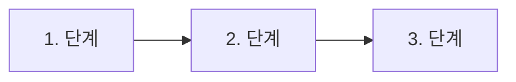

# User Workflow (사용자 흐름) — 초안

> PRD 전에 채우는 공개 템플릿/요약. 승인된 Linear 원본이 우선한다. 고객 원문과 내부 결정은 여기에 복사하지 않는다.

- 원본 참조: 미연결 (공개 가능한 식별자만 기재)
- 참조 버전/확인일: 미정
- 상태: 템플릿 — 대상 제품 미선택, 실제 사용자 관찰 없음

## 0. 진행 순서와 시작 조건

| 순서 | 산출물 | 시작 조건 |
|---|---|---|
| 1 | 사용자 흐름 (이 문서) | 검증할 제품 후보 1개가 정해짐 |
| 2 | PRD (`docs/prd.md`) | 이 문서의 1–4절이 채워지고 사람이 흐름을 확인함 |
| 3 | 디자인 (Claude Design) | PRD를 사람이 수락함. Claude Design 가용성을 확인함 |
| 4 | 백엔드 API spec | 이 문서의 2–3절을 사람이 확인하고 PRD를 사람이 수락함. 디자인과 병행할 수 있음 |
| 5 | 기술 검토·구현 | [spec-flow의 '탐색에서 개발로'](harness/spec-flow.md#탐색에서-개발로) 조건을 충족함. 디자인·API spec을 함께 검토함 |

각 산출물은 표의 시작 조건을 충족한 뒤에 작성하며, 디자인과 백엔드 API spec은 병행할 수 있다. 시작 조건이 충족되지 않았으면 해당 단계 섹션을 채우지 않는다. 특히 5절(디자인)은 PRD 수락 전에 비워 둔다.

## 작성 규칙 (AI 에이전트·사람 공통)

- 각 항목 끝에 근거 구분을 붙인다: `[사실]` 관찰·데이터로 확인됨, `[가설]` 우리 추정, `[미확인]` 아직 모름.
- `[사실]`에는 근거 위치(Linear 이슈 ID, 공개 가능한 자료명)를 함께 적는다. 근거 없는 수치·기간·비율을 만들지 않는다.
- 흐름 하나는 사용자 목표 하나를 다룬다. 목표가 둘이면 2절 표를 나눈다.
- 화면 모양이 아니라 사용자 행동과 결과를 적는다. 버튼 배치·색 같은 결정은 5절로 미룬다.
- 고객 발언 원문 대신 익명 요약을 쓴다. 원문은 접근이 제한된 Linear 원본에 둔다.
- Linear 원본과 이 문서가 다르면 원본을 따르고, 차이를 이슈에 기록한 뒤 이 문서를 고친다.

## 1. 대상 사용자와 사용 상황

- 사용자:
- 사용 상황 (흐름이 시작되는 계기):
- 사용자가 이루려는 목표:
- 지금 쓰는 대안·우회 방법:
- 근거:

## 2. 핵심 흐름

- 흐름 이름:
- 시작 조건:
- 끝 조건 (사용자가 목표를 이뤘다고 볼 수 있는 상태):

| 단계 | 사용자 행동 | 시스템 반응 | 막히는 지점·감정 | 근거 구분 |
|---|---|---|---|---|
| 1 |  |  |  |  |
| 2 |  |  |  |  |
| 3 |  |  |  |  |

흐름 그림이 필요하면 아래 형식을 쓴다. 표와 단계 번호를 맞춘다.

## 3. 예외·이탈 흐름

| 관련 단계 | 발생 조건 | 사용자에게 보이는 결과 | 복구 방법 | 근거 구분 |
|---|---|---|---|---|
|  |  |  |  |  |

## 4. PRD로 넘길 항목

| 흐름 단계 | PRD 섹션 | 넘길 내용 | 근거 구분 |
|---|---|---|---|
|  | 1. 한 문장 설명 |  |  |
|  | 2. 사용자와 상황 |  |  |
|  | 3. 목표와 성공 확인 (가설·관찰할 행동) |  |  |
|  | 4. 범위 (Must·Later·이번에는 만들지 않음) |  |  |
|  | 5. 사용자 스토리·완료 조건 |  |  |
|  | 6. 비기능·열린 질문 |  |  |

PRD를 쓰는 에이전트는 이 표를 입력으로 사용하고, 표에 없는 문제나 가설을 PRD에 추가하면 그 출처를 따로 적는다.

## 5. 디자인 단계 연결 (PRD 수락 후 작성)

- PRD 수락 기록 (Linear 이슈·결정일):
- Claude Design 가용성 확인 (확인일·결과):
- 대체 방법 (사용할 수 없을 때): 와이어프레임으로 검토
- 디자인 입력: 이 문서 2·3절, PRD 범위·비목표
- 프로토타입 링크·버전:
- 흐름 단계 ↔ 화면 대응:

| 흐름 단계 | 화면·상태 | 프로토타입 위치 |
|---|---|---|
|  |  |  |

## 6. 단계별 점검

- [ ] 1–3절의 모든 항목에 근거 구분이 붙어 있다.
- [ ] `[사실]` 항목마다 근거 위치가 있다.
- [ ] 4절 표가 PRD 1–6절에 대응한다.
- [ ] 사람이 흐름을 확인한 기록(Linear 이슈·일자)이 원본 참조에 있다.
- [ ] 5절은 PRD 수락 기록이 생긴 뒤에만 채워졌다.

## 변경 이력
- 2026-10-20: 템플릿 생성 (MEG-32)
- 2026-10-20: 0절에 백엔드 API spec 단계 추가 (MEG-36)
- 2026-10-21: 4절 표·6절 점검을 PRD 6절 구조에 맞춤 (MEG-37)
