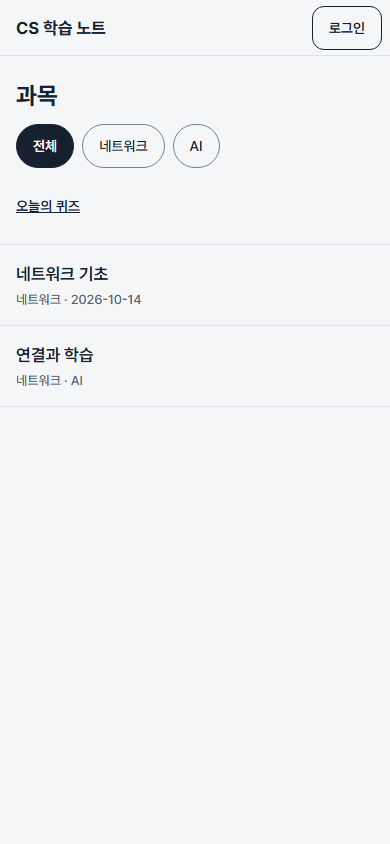
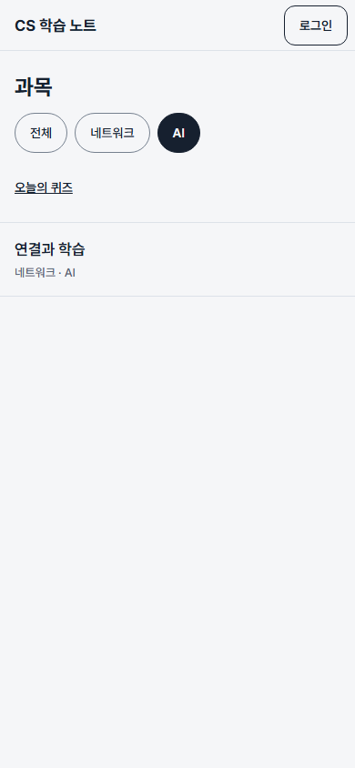
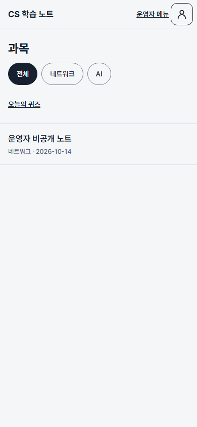
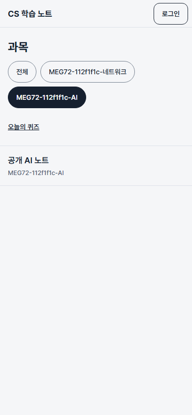
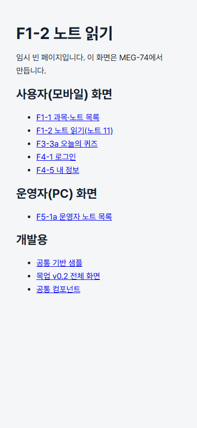

# MEG-72 목록 화면 검증

`/`에서 실제 `GET /api/notes`를 부른다. 과목 선택은 `?subject_id=`로 유지하며 노트는 `/notes/:noteId`로 연결한다. `VITE_API_MOCK=true`이면 기존 공통 가짜 응답을 사용한다.

## 확인한 것

- AC-1: 과목 선택 시 해당 E04 응답의 노트만 표시한다. 공개 여부는 서버가 판정한다. 로컬 Supabase에 합성 공개 2·비공개 1을 넣고 실제 FastAPI와 Vite 프록시를 통해 방문자 화면·과목 필터·비공개 제외를 확인했다.
- AC-2: 노트를 누르면 해당 ID의 읽기 경로로 이동한다. 브라우저 뒤로 가기로 과목 선택이 복원된다. 읽기 본문은 MEG-74에서 구현하므로 현재는 임시 화면이다.
- Chromium 목록 시험 7건: 선택/이동/복원, 빈 전체·과목, 503 재시도, 늦은 응답, 운영자, 일반 사용자·320px·키보드, 네트워크 오류·422 복구.
- 로그인 회귀 8건 및 기존 목업 42건 통과. 로그인 시험의 임시 목록 화면 전제를 수정했다. lint·TypeScript/Vite build 및 diff 공백 검사 통과.

실제 DB 연결 확인은 저장소 밖 임시 스크립트로 실행했으며 테스트 데이터를 삭제하고 앱 서버·DB 컨테이너를 종료했다. 포트 설정도 원복했다. 화면 기록은 합성 데이터만 포함한다.

| 기본 | 과목 선택 | 운영자 |
|---|---|---|
|  |  |  |

| 실제 로컬 DB 필터 | 읽기 경로 이동 |
|---|---|
|  |  |

## 범위와 한계

- 목업 v0.2의 목록 배치와 기존 디자인 시스템의 AppHeader·Chip·NoteListItem·StateMessage·Button을 재사용했다. 헤더 높이는 기존 공통 컴포넌트의 56px다.
- 로그인·내 정보·운영자 메뉴·오늘의 퀴즈는 기존 경로에 연결한다. 계정 메뉴/로그아웃 및 F1-1c 로그인 안내 시트는 구현하지 않았다. 방문자의 퀴즈 링크는 로그인 화면으로 바로 간다. 별도 화면 흐름을 이번 티켓에서 확장하지 않았다.
- 오류·로딩·전체 빈 목록 문구는 임시 문구다. 학습일이 null이면 날짜를 생략한다. 운영자는 서버가 반환한 비공개 노트도 표시한다.
- 브라우저 목록 시험의 HTTP 응답은 합성 fixture다. 실제 DB 브라우저 시험은 방문자 기준이며 원격 환경·로그인 사용자/운영자의 전체 실제 DB 화면 흐름·Safari/Firefox·실제 모바일 기기·스크린 리더는 미검증이다.
- PR Preview에서 실제 DB로 사용하려면 해당 브랜치 전용 테스트 Supabase 설정과 ALLOWED_ORIGINS를 등록하고 재배포해야 한다. 설정이 없는 Preview의 오류를 API 정상 동작으로 간주하지 않는다.

## 재현

```sh
npm ci
npm run lint
npm run build
npm run test:e2e:notes
npm run test:e2e
```

Playwright Chromium이 필요하다. 목록 시험은 포트 4184, 기존 시험은 4183의 전용 Vite 서버를 사용한다. 저장소 안에 자동 실제 DB 브라우저 시험은 추가하지 않았다.
