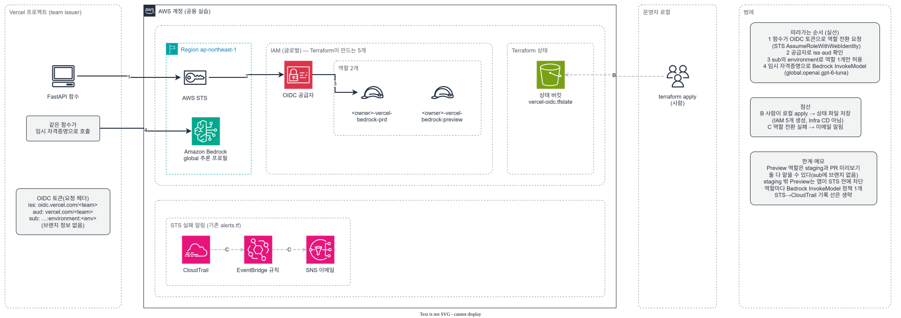

# infra — AWS 운영 설정

AWS 계정의 비용 경보, 감사 로그, 감사 이벤트 알림을 Terraform으로 관리한다(MEG-99). AI는 코드와 PR을 만들고 `init`·`plan`까지 실행할 수 있다. `apply`와 상태 버킷 생성, 시험 이벤트는 사람이 한다(2026-10-26 결정). `main`에 병합한 뒤의 변경은 GitHub Actions가 plan을 만들고 사람이 승인하면 적용한다("CD로 적용" 절, MEG-100).

공개 저장소라서 계정 ID·이메일·예산 금액·버킷 이름은 커밋하지 않는다. 이 값은 `terraform.tfvars`와 `backend.hcl`에만 둔다. 두 파일은 `.gitignore`에 들어 있다. 상태 파일과 plan 파일에도 이 값이 평문으로 들어가므로 상태 버킷을 읽을 수 있는 사람은 비공개 값도 볼 수 있다.

## 공용 실습 계정 규칙

이 계정은 메가존클라우드가 여러 명에게 함께 준 실습 계정이고, 비용이 실제로 청구된다. `infra/`로 만들거나 바꾸는 리소스는 아래 규칙을 지킨다.

- **Owner 태그:** 모든 리소스에 `Owner = 이메일 @ 앞부분` 태그를 단다. provider의 `default_tags`가 `var.owner` 값으로 자동으로 붙인다. Terraform 밖에서 만든 상태 버킷은 사람이 직접 태그를 단다("처음 한 번" 절).
- **이름 접두사:** 새로 만드는 리소스 이름 앞에 `<owner>-`를 붙여 다른 사람 리소스와 구분한다. 콘솔에서 만들어 가져온 예산·이상 탐지 구독·트레일·로그 버킷은 이름을 바꾸면 새로 만들어지므로 이름을 그대로 두고 Owner 태그로 구분한다.
- **정리:** 수업이 끝나면 직접 만든 리소스를 지운다. 절차와 확인 방법은 "정리(삭제) 방법" 절에 있다.
- **시간 과금 리소스:** 이 폴더의 리소스(예산, 비용 이상 탐지, CloudTrail 관리 이벤트 트레일, S3, SNS, EventBridge, IAM OIDC 공급자·역할)는 시간당 과금이 없다. EC2·NAT 게이트웨이·탄력적 IP·RDS·OpenSearch·SageMaker 엔드포인트처럼 켜 두는 동안 과금되는 리소스를 추가할 때는 쓴 직후 지우는 절차를 함께 적는다. EC2는 중지가 아니라 종료한다. 중지만 하면 EBS 볼륨과 탄력적 IP는 계속 과금된다.
- **사용 금지:** AWS Marketplace 유료 구독, Support 플랜 변경, Shield Advanced 같은 고비용 구독 서비스는 만들지 않는다. 계획에 들어 있으면 만들기 전에 알린다.
- **정기 점검:** 운영 담당자가 계정을 정기 점검한다. `Owner` 태그가 없거나 오래 쓰지 않은 리소스는 안내 없이 삭제될 수 있다. 보관할 데이터(예: CloudTrail 로그)는 따로 백업한다.

## 관리하는 것

| 파일 | 리소스 | 리전 | 출처 |
|---|---|---|---|
| `budget.tf` | 월 예산 `cs-learning-monthly`와 경보 4개(실제 50·80·100%, 예상 100%), 비용 이상 탐지 모니터 `<owner>-cs-learning-cost-monitor`·구독 `daily-cost-anomaly` | 글로벌 | 콘솔에서 만든 것을 가져옴 |
| `cloudtrail.tf` | 트레일 `cs-learning-audit`, 로그 버킷과 공개 차단·암호화·소유권·정책 | ap-northeast-2 | 콘솔에서 만든 것을 가져옴 |
| `alerts.tf` | SNS 토픽 `<owner>-cs-learning-audit-alerts`·이메일 구독, EventBridge 규칙 `<owner>-cs-learning-…`·대상 | ap-northeast-1(STS), us-east-1(IAM) | 새로 만듦 |
| `github-oidc/` | GitHub OIDC 공급자, IAM 역할 `<owner>-infra-plan`·`<owner>-infra-apply` | 글로벌 | 새로 만듦. CD 전용이며 상태 파일이 따로다. CD가 아니라 사람이 로컬에서 적용한다 |
| `vercel-oidc/` | Vercel OIDC 공급자(team issuer), IAM 역할 `<owner>-vercel-bedrock-prd`·`<owner>-vercel-bedrock-preview`와 Bedrock 호출 정책 | 글로벌(호출 리전 ap-northeast-1) | 새로 만듦(MEG-119). 상태 파일이 따로이고 사람이 로컬에서 적용한다. "Vercel OIDC 역할" 절 참고 |
| `db-backup/` | 백업 버킷 `<owner>-cs-learning-db-backup`(공개 차단·SSE-S3·TLS 강제·버전 관리·수명 주기), IAM 역할 `<owner>-db-backup`과 업로드 정책 | ap-northeast-2(역할은 글로벌) | 새로 만듦(MEG-94). 상태 파일이 따로이고 사람이 로컬에서 적용한다. "DB·이미지 백업" 절 참고 |

`imports.tf`의 `import` 블록이 콘솔 리소스를 상태로 가져온다. 가져온 리소스는 `plan`에서 변경·삭제가 0건이어야 한다.

알림 규칙은 2개다.

- OIDC 역할 전환 실패: `sts:AssumeRoleWithWebIdentity` 중 `errorCode`가 있는 이벤트. 백엔드가 STS를 부르는 리전(`sts_event_region`, 기본 ap-northeast-1)에 기록된다.
- 서비스 전용 자격증명 생성: `iam:CreateServiceSpecificCredential`. IAM은 us-east-1에만 기록된다.

EventBridge 규칙은 같은 리전의 SNS 토픽에만 보낼 수 있어서 리전마다 토픽과 이메일 구독을 하나씩 둔다. 확인 메일도 2통 온다. STS 호출은 읽기 전용 관리 이벤트라서 규칙 상태를 `ENABLED_WITH_ALL_CLOUDTRAIL_MANAGEMENT_EVENTS`로 둔다. 이 상태는 콘솔에서 고를 수 없다.

## 처음 한 번: 상태 버킷 만들기 (사람)

상태 파일 전용 S3 버킷을 만든다. 이름은 전역에서 겹치지 않아야 하므로 owner 접두사와 계정 ID를 붙인다(예: `<owner>-cs-learning-tfstate-<계정 ID>`). 이 버킷은 Terraform 밖에서 만들므로 Owner 태그도 직접 단다. PowerShell 기준이다.

```powershell
$b = "<상태 버킷 이름>"
$o = "<owner>"
aws s3api create-bucket --bucket $b --region ap-northeast-2 --create-bucket-configuration LocationConstraint=ap-northeast-2
aws s3api put-bucket-versioning --bucket $b --versioning-configuration Status=Enabled
aws s3api put-public-access-block --bucket $b --public-access-block-configuration BlockPublicAcls=true,IgnorePublicAcls=true,BlockPublicPolicy=true,RestrictPublicBuckets=true
aws s3api put-bucket-tagging --bucket $b --tagging "TagSet=[{Key=Owner,Value=$o}]"
```

새 버킷은 기본으로 SSE-S3 암호화가 켜진다. 네 설정을 확인한다.

```powershell
aws s3api get-bucket-versioning --bucket $b      # Status: Enabled
aws s3api get-public-access-block --bucket $b    # 네 항목 모두 true
aws s3api get-bucket-encryption --bucket $b      # SSEAlgorithm: AES256
aws s3api get-bucket-tagging --bucket $b         # Owner 태그
```

잠금은 S3 잠금 파일(`use_lockfile`)을 쓰므로 DynamoDB 테이블은 만들지 않는다.

## 적용 순서

1. 설정 파일 두 개를 복사하고 실제 값을 채운다.
   ```powershell
   cd infra
   Copy-Item backend.hcl.example backend.hcl
   Copy-Item terraform.tfvars.example terraform.tfvars
   ```
   `owner`에는 이메일 @ 앞부분을 적는다. 모니터·구독 ID는 ARN의 마지막 UUID다.
2. 초기화한다.
   ```powershell
   terraform init -backend-config=backend.hcl
   ```
3. 계획을 만든다.
   ```powershell
   terraform plan -out=plan.tfplan
   ```
   처음에는 `Plan: 9 to import, 10 to add, 2 to change, 0 to destroy.`가 나와야 한다. 바뀌는 2건은 예산과 비용 이상 탐지 구독이다. 이메일·금액 변수가 `sensitive`라서 가져온 값에 가림 표시가 붙는 것뿐이며 실제 값은 같다(`limit_amount`에 "The value is unchanged"가 보인다). 2026-10-26 `sensitive`를 잠시 끄고 돌린 plan은 `0 to change`였다. 이 2건 말고 가져오는 리소스에 `~`(변경)나 `-`(삭제)가 보이면 적용하지 말고 해당 부분 출력을 이슈에 남긴다. 출력을 옮길 때는 계정 ID, 이메일, 로그 버킷 이름을 가린다. ARN에도 계정 ID가 들어 있다. 코드를 고친 뒤 다시 `plan`한다.

   plan 파일(`plan.tfplan`)에는 이메일·금액·계정 ID가 평문으로 들어간다. `.gitignore`가 막지만 적용 뒤에는 지운다.
4. 적용한다.
   ```powershell
   terraform apply plan.tfplan
   Remove-Item plan.tfplan
   ```
5. 받은편지함에서 `AWS Notification - Subscription Confirmation` 메일 2통의 확인 링크를 누른다.
6. 다시 `terraform plan`을 실행해 `No changes.`인지 확인한다.

## 시험 이벤트

적용과 구독 확인이 끝난 뒤 실행한다. 메일은 보통 몇 분 안에 오지만 늦을 수 있다. 15분이 지나도 안 오면 해당 리전의 CloudTrail 이벤트 기록에서 이벤트가 기록됐는지부터 본다.

**1. OIDC 역할 전환 실패 (ap-northeast-1)**

형식이 틀린 토큰으로는 시험할 수 없다. 2026-10-26 `--web-identity-token invalid`로 호출하면 `InvalidIdentityToken`("not a valid JWT")이 났지만, 이틀 뒤까지 CloudTrail 기록이 없었고 규칙도 반응하지 않았다. 토큰 형식부터 틀린 요청은 CloudTrail에 남지 않는 것으로 보인다.

이 규칙은 OIDC 공급자와 역할이 있는 상태에서 실제 토큰이 거부될 때(예: 2026-10-22에 기록된 `AccessDenied`) 반응한다. 지금 계정에는 OIDC 역할이 없어서 이 시험은 역할을 다시 만들 때 한다. 그 전에는 규칙 상태(`ENABLED_WITH_ALL_CLOUDTRAIL_MANAGEMENT_EVENTS`)와 구독 확인, 아래 2번 시험으로 SNS 전달 경로를 확인한다(2026-10-28 결정).

**2. 서비스 전용 자격증명 생성 후 삭제 (us-east-1)**

권한 없는 임시 사용자(owner 접두사와 Owner 태그를 붙인다)에 1일짜리 키를 만들고 바로 지운다. `--query`로 ID만 받아서 키 값은 화면에 나오지 않는다. 그래도 Claude Code의 `!` 대신 별도 PowerShell 창에서 실행한다.

PowerShell은 명령이 실패해도 다음 줄로 넘어가므로 아래 블록은 실패하면 바로 멈춘다. `--tags` 값은 따옴표로 감싼다. 감싸지 않으면 PowerShell이 쉼표를 배열 구분자로 읽어 `ValidationError`가 난다.

```powershell
$o = "<owner>"; $u = "$o-meg99-alert-test"
& {
  aws iam create-user --user-name $u --tags "Key=Owner,Value=$o" | Out-Null
  if ($LASTEXITCODE) { "실패: 사용자 생성"; return }
  $id = aws iam create-service-specific-credential --user-name $u --service-name bedrock.amazonaws.com --credential-age-days 1 --query ServiceSpecificCredential.ServiceSpecificCredentialId --output text
  if ($LASTEXITCODE -or -not $id) { "실패: 키 생성 — 사용자만 지움"; aws iam delete-user --user-name $u; return }
  aws iam delete-service-specific-credential --user-name $u --service-specific-credential-id $id
  if ($LASTEXITCODE) { "실패: 키 삭제 — 아래 명령으로 정리"; return }
  aws iam delete-user --user-name $u
  if ($LASTEXITCODE) { "실패: 사용자 삭제 — 아래 명령으로 정리"; return }
  "정리 완료"
}
aws iam get-user --user-name $u   # NoSuchEntity 오류가 나야 정리된 것이다
```

이 규칙은 키 생성이 실패한 시도(예: 없는 사용자)에도 알림을 보낸다.

중간에 실패했으면 아래로 남은 키를 찾아 지운 뒤 사용자를 지운다.

```powershell
aws iam list-service-specific-credentials --user-name $u --query "ServiceSpecificCredentials[].ServiceSpecificCredentialId" --output text
```

메일 수신 시각을 이슈에 남긴다.

## 되돌리기

- **알림만 끄기:** `alerts.tf`를 지우고 `plan`→`apply`한다. 토픽·구독·규칙 10개가 삭제된다.
- **가져오기 PR(MEG-99)은 revert하지 않는다.** revert하면 가져온 예산·트레일·버킷 설정이 삭제 대상이 된다. 가져온 리소스는 아래 `removed` 블록으로만 관리에서 뺀다.
- **이후 변경 되돌리기:** 가져오기 이후의 변경 PR은 revert한 뒤 `plan`으로 차이를 확인하고 `apply`한다. `plan`에 가져온 리소스의 삭제가 보이면 적용하지 않는다.
- **가져온 리소스를 Terraform 관리에서 빼기:** 리소스 블록을 지우고 아래 블록을 넣어 `apply`한다. AWS에서는 지워지지 않는다.
  ```hcl
  removed {
    from = aws_cloudtrail.audit
    lifecycle {
      destroy = false
    }
  }
  ```
- 수업 중에는 `terraform destroy`를 쓰지 않는다. 로그 버킷은 `prevent_destroy`로 막아 두었다. 수업이 끝난 뒤의 삭제는 아래 "정리(삭제) 방법"을 따른다.

## CD로 적용 (MEG-100)

`infra/` 변경을 `main`에 병합하면 `.github/workflows/infra-cd.yml`이 plan을 만들고, 사람이 승인한 뒤에 같은 plan을 적용한다. 로컬 AWS 자격증명이 없어도 `infra/`를 바꿀 수 있다. 첫 적용과 `infra/github-oidc/`·`infra/vercel-oidc/` 변경은 CD 대상이 아니고 사람이 로컬에서 한다.

**흐름**

1. `infra/*.tf`나 `infra/.terraform.lock.hcl`을 바꾼 PR이 `main`에 병합된다. README·예시 파일만 바꾼 병합과 하위 폴더(`infra/github-oidc/`, `infra/vercel-oidc/`)는 실행하지 않는다. 수동 실행(`workflow_dispatch`)도 된다. PR 단계에서는 plan이 돌지 않는다. PR 검토 때는 로컬 `plan`을 쓴다.
2. **Plan** job(Environment `infra-plan`)이 OIDC로 읽기 전용 역할 `<owner>-infra-plan`을 맡아 `plan`을 만든다. 로그에는 `Plan: …` 줄과 바뀌는 리소스 주소·동작 목록만 남는다. 바뀔 것이 없으면 여기서 끝난다.
3. plan 파일을 상태 버킷의 `plans/<실행 번호>.tfplan`에 올린다. 공개 저장소의 Actions 아티팩트는 쓰지 않는다.
4. **Apply** job(Environment `infra-apply`)은 필수 승인자가 승인하기 전에는 시작하지 않는다. 승인하면 역할 `<owner>-infra-apply`를 맡아 올린 plan 파일만 적용하고 파일을 지운다. 그 사이 상태가 바뀌었으면 Terraform이 적용을 거부한다.
5. 같은 시각에 실행은 하나만 돈다(`concurrency`).

**처음 한 번 (사람)**

1. **plan 파일 만료 규칙:** 상태 버킷은 버전 관리가 켜져 있어 지워도 이전 버전이 남는다. `plans/` 아래만 하루 뒤 지우는 규칙을 건다. 승인을 거절해 남은 plan 파일도 이 규칙으로 사라진다. 이 명령은 버킷의 기존 수명 주기 규칙을 덮어쓴다(새 버킷에는 규칙이 없다).
   ```powershell
   $b = "<상태 버킷 이름>"
   '{"Rules":[{"ID":"expire-plans","Status":"Enabled","Filter":{"Prefix":"plans/"},"Expiration":{"Days":1},"NoncurrentVersionExpiration":{"NoncurrentDays":1}}]}' | Set-Content -Encoding ascii lifecycle.json
   aws s3api put-bucket-lifecycle-configuration --bucket $b --lifecycle-configuration file://lifecycle.json
   Remove-Item lifecycle.json
   aws s3api get-bucket-lifecycle-configuration --bucket $b   # expire-plans 규칙이 보여야 한다
   ```
2. **역할 만들기:** `infra/github-oidc/`에서 사람이 로컬에서 적용한다. `owner`·버킷 이름은 `infra/`와 같은 값을 쓴다. OIDC 공급자는 계정에 하나만 만들 수 있다. 이미 있으면 `apply`가 `EntityAlreadyExists`로 실패하므로 먼저 `aws iam list-open-id-connect-providers`로 확인한다(2026-10-28 이 계정에는 없었다).
   ```powershell
   cd infra\github-oidc
   Copy-Item terraform.tfvars.example terraform.tfvars   # 값을 채운다
   terraform init "-backend-config=../backend.hcl"
   terraform plan "-out=plan.tfplan"
   terraform apply plan.tfplan
   Remove-Item plan.tfplan
   terraform output
   ```
   `plan`은 `Plan: 5 to add, 0 to change, 0 to destroy.`가 나와야 한다(공급자 1, 역할 2, 역할 정책 2). 출력된 역할 ARN 두 개를 다음 단계에서 쓴다. ARN에는 계정 ID가 있으므로 이슈나 PR에 옮기지 않는다.
3. **GitHub Environment 만들기:** 저장소 Settings → Environments에서 두 개를 만든다.
   - `infra-plan`: Deployment branches and tags를 **Selected branches and tags**로 하고 `main`만 넣는다.
   - `infra-apply`: 같은 배포 브랜치 규칙에 **Required reviewers**로 승인자를 넣는다. 승인자가 병합한 사람과 같아서 "Prevent self-review"는 끈다. 승인은 여전히 별도 클릭이다.
   - 이 브랜치 규칙이 `main` 밖의 브랜치가 두 역할을 맡지 못하게 하는 장치다. 역할 신뢰 정책은 저장소와 Environment 이름만 보고 브랜치는 보지 않는다.
   - 신뢰 정책의 `sub`는 이 저장소의 불변 형식(`repo:<owner>@<소유자 ID>/<name>@<저장소 ID>:environment:<이름>`)이다. 이름만 쓴 `repo:<owner>/<name>:environment:…`로는 역할 전환이 거부된다(`Not authorized to perform sts:AssumeRoleWithWebIdentity`). 값은 `gh api repos/<owner>/<name>/actions/oidc/customization/sub`의 `sub_claim_prefix`에서 확인하고, `variables.tf`의 `github_subject_repository`에 있다. 저장소를 다른 소유자로 넘기거나 새로 만들면 ID가 바뀌므로 이 값을 고쳐 다시 적용한다.
4. **비밀값 넣기:** 저장소 비밀값이 아니라 각 Environment의 Secrets에 넣는다. 저장소 비밀값은 `main` 밖의 브랜치 워크플로도 읽을 수 있다.

   | Environment | 이름 | 값 |
   |---|---|---|
   | `infra-plan` | `AWS_ROLE_ARN` | `terraform output`의 `plan_role_arn` |
   | `infra-plan` | `TF_STATE_BUCKET` | 상태 버킷 이름 |
   | `infra-plan` | `TF_VARS_JSON` | 아래 한 줄 JSON |
   | `infra-apply` | `AWS_ROLE_ARN` | `terraform output`의 `apply_role_arn` |
   | `infra-apply` | `TF_STATE_BUCKET` | 상태 버킷 이름 |

   `TF_VARS_JSON`은 `infra/terraform.tfvars`의 변수를 한 줄 JSON으로 합친 값이다. 값마다 비밀값으로 두면 예산 같은 짧은 숫자가 로그의 다른 숫자까지 `***`로 가린다. 아래 명령이 클립보드에 복사하므로 그대로 붙여 넣는다.
   ```powershell
   @{
     owner                   = "<owner>"
     alert_email             = "<알림 이메일>"
     monthly_budget_usd      = "<월 예산>"
     cloudtrail_bucket_name  = "<로그 버킷 이름>"
     anomaly_monitor_id      = "<모니터 UUID>"
     anomaly_subscription_id = "<구독 UUID>"
   } | ConvertTo-Json -Compress | Set-Clipboard
   ```
   `infra/`에 변수를 추가하면 이 JSON에도 키를 추가해야 plan이 돈다. `budget_start`·`home_region`·`sts_event_region`은 기본값을 쓰면 넣지 않는다.

**승인하는 법**

1. 저장소 Actions 탭에서 `Infra CD` 실행을 연다. Plan job 로그의 `Plan: …` 줄과 "승인할 변경" 목록을 병합한 PR과 비교한다. 목록에는 `create`, `update`, `delete`, `import+no-op` 같은 동작과 리소스 주소만 있다. 값은 없다. 값 변경은 PR diff로 확인한다.
2. `delete`가 있거나 PR에 없는 리소스가 보이면 승인하지 않고 거절한다.
3. 이상이 없으면 **Review deployments**에서 `infra-apply`를 승인한다.
4. Apply job 로그의 `Apply complete!` 줄을 확인한다. 이어서 로컬 또는 다음 CD 실행의 `plan`이 `No changes.`인지 본다.

**실패했을 때**

- **plan·init·apply가 실패:** 공개 로그라서 Terraform 출력을 남기지 않는다. 종료 코드만 보인다. 같은 커밋을 로컬에서 `plan`해 원인을 본다.
- **plan 단계가 인증 뒤에 실패:** 공개 로그에는 출력이 없어서 어떤 호출이 거부됐는지 보이지 않는다. 읽기 호출은 CloudTrail 이벤트 기록에 남으므로 실행 시각 전후로 `GitHubActions` 세션의 거부 기록을 찾는다. 서울(`ap-northeast-2`), 도쿄(`ap-northeast-1`), 버지니아(`us-east-1`)를 모두 본다.
  ```powershell
  aws cloudtrail lookup-events --region us-east-1 --lookup-attributes AttributeKey=Username,AttributeValue=GitHubActions --start-time <UTC 시작 시각> --query "Events[].CloudTrailEvent" --output text
  ```
  결과 중 `errorCode`가 `AccessDenied`인 이벤트의 `errorMessage`에 거부된 동작과 리소스가 있다. 이벤트가 도착하는 데 몇 분 걸릴 수 있다. 2026-10-28 첫 실행은 `sns:GetSubscriptionAttributes`(SNS는 구독이 아니라 토픽 ARN으로 검사한다)와 `s3:ListTagsForResource`(로그 버킷 태그)가 빠져 있었다. 이 방법으로 찾았다. 권한을 더한 뒤 사람이 `infra/github-oidc`를 다시 적용한다.
- **apply가 `AccessDenied`:** `infra/`에 새 리소스 종류를 추가했는데 apply 역할이 모르는 것이다. `infra/github-oidc/main.tf`의 정책에 권한을 더하는 PR을 올리고, 병합 뒤 사람이 로컬에서 `infra/github-oidc`를 적용한다. 의도적으로 뺀 권한(트레일·로그 버킷·로그 버킷 정책 삭제, IAM 쓰기)이 필요한 plan은 로컬에서 직접 적용한다.
- **apply가 중간에 실패:** 일부 리소스는 이미 바뀌었을 수 있다. 상태를 믿고 로컬에서 `plan`해 차이를 본 뒤 다시 `main`에 고치는 PR을 올리거나 로컬에서 적용한다. 상태 파일은 apply가 실패해도 쓴 곳까지 기록된다.
- **승인을 거절했거나 시간이 지났다:** plan 파일은 하루 안에 만료 규칙으로 사라진다. 다시 적용하려면 Actions에서 `Infra CD`를 `main`에서 수동 실행하거나 실행을 다시 돌린다. 오래된 plan은 상태가 바뀌었으면 적용되지 않는다.

**되돌리기**

- 변경을 되돌리려면 변경 PR을 revert하는 PR을 올려 병합하고 CD 승인을 거친다. 가져온 리소스를 삭제하는 revert는 위 "되돌리기" 절의 주의를 따른다.
- CD를 끄려면 `.github/workflows/infra-cd.yml`을 지우는 PR을 올린다. AWS 쪽 역할은 "정리(삭제) 방법"의 6단계에서 지운다. 비상 때는 `infra-apply` Environment를 지우거나 역할 정책을 비워도 apply가 멈춘다.

**알아 둘 것**

- 로그에는 리소스 주소가 나온다. `for_each` 키나 이름에 이메일·계정 ID 같은 비공개 값을 넣지 않는다.
- plan 파일에는 변수 값이 평문으로 들어 있다. 파일은 비공개·암호화된 상태 버킷에만 있고 하루 안에 지워진다. 그동안은 상태 버킷을 읽을 수 있는 사람이 볼 수 있다. plan 역할은 `plans/`에 쓰기만 하고 읽지 못한다. apply 역할만 읽는다.
- Environment 비밀값은 저장소 관리자가 덮어쓸 수 있다. 비밀값을 바꾼 이력은 GitHub 감사 기록에 남는다.
- OIDC 역할 전환이 거부되면 `infra/alerts.tf`의 STS 알림 규칙이 반응한다. 워크플로는 이 규칙이 보는 리전(`ap-northeast-1`)으로 역할을 요청한다.
- IAM 역할의 `description`에는 한글을 쓰지 못한다(ASCII·Latin-1만). 한글이 있으면 `plan`·`validate`는 통과하고 `apply`의 `CreateRole`에서 `ValidationError`가 난다(2026-10-28 MEG-100 첫 `apply`에서 겪음). 중간에 실패한 `apply`는 이미 만든 리소스(OIDC 공급자)를 상태에 남기므로 코드를 고친 뒤 `plan`을 다시 만들어 적용한다.

## Vercel OIDC 역할 (MEG-119)

Vercel 배포의 FastAPI가 장기 키 없이 Bedrock을 부를 때 맡는 역할이다. 백엔드는 요청 헤더의 Vercel OIDC 토큰을 STS(`ap-northeast-1`)에 넘겨 임시 자격증명을 받는다(`backend/app/bedrock.py`, `docs/ai-credentials.md`). 운영 결정과 검증은 MEG-118에서 추적한다.



그림의 원본은 `vercel-oidc/architecture.spec.json`이다. `~/.claude/skills/aws-k8s-architecture-diagram`의 생성기(`build_diagram.js`)로 `.drawio`를 만들고 draw.io CLI로 `.drawio.svg`를 내보낸다. `.drawio.svg`를 draw.io에서 직접 고치면 명세와 어긋나므로 명세를 고쳐 다시 만든다.

**구성**

- 공급자: Vercel 프로젝트가 team issuer 모드라서 URL은 `https://oidc.vercel.com/<team>`, audience는 기본값 `https://vercel.com/<team>`이다. 프로젝트 설정에서 issuer 모드를 바꾸면 공급자 URL도 바뀌어 역할 전환이 거부된다.
- 역할 2개: 신뢰 정책이 `aud`와 `sub`(`owner:<team>:project:<project>:environment:<env>`)를 `StringEquals`로 고정한다. `prd`는 `production`, `preview`는 `preview` 토큰만 받는다. Preview 토큰으로 운영 역할을 맡을 수 없다.
- 권한: 두 역할 모두 글로벌 추론 프로필 `global.<모델>`의 `bedrock:InvokeModel`만 있다. 추론 프로필·호출 리전 기반 모델·글로벌 기반 모델 3문장이며, 모델 문장은 이 추론 프로필을 거칠 때만 허용한다(AWS 문서 "Global cross-Region inference"의 IAM 예시와 같은 구조).
- **한계:** Vercel 토큰 `sub`에는 브랜치가 없다. 그래서 Preview 역할은 `staging`뿐 아니라 PR 미리보기 배포도 맡을 수 있다. 빌드 단계에도 토큰이 나오므로 PR이 바꾼 빌드 스크립트·의존성 설치 스크립트도 포함된다.
  - 장치 1: `AWS_ROLE_ARN`을 Preview의 Git Branch `staging` 범위에만 넣는다. Vercel 프로젝트의 Git Fork Protection이 켜져 있어 외부 fork PR은 사람 승인 전에 배포되지 않는다(2026-10-29 확인).
  - 장치 2: 백엔드가 `staging` 밖의 Preview에서는 STS 호출 전에 거부한다(MEG-120, `backend/app/bedrock.py`의 `ai_allowed_in_environment`, `docs/ai-credentials.md` "배포 환경 제한" 절).
  - 남는 위험: 팀원·AI가 올린 PR의 코드가 역할 ARN을 직접 넣어 STS를 부르는 경우는 막지 못한다. 2026-10-29에 수용했다(MEG-118). 비용 피해는 `budget.tf`의 월 예산 경보로 알 수 있다.
- 팀 슬러그에는 개인 식별 정보가 들어 있을 수 있어 `terraform.tfvars`로만 넘긴다. `for_each` 키와 리소스 이름에도 넣지 않는다.
- IAM 조건은 팀·프로젝트의 불변 ID가 아니라 슬러그와 이름을 본다. Vercel 팀이나 프로젝트 이름을 바꾸면 역할 전환이 거부되고, 풀린 옛 슬러그를 다른 팀이 가져갈 수도 있다. 이름을 바꿨으면 이 폴더를 `destroy`한 뒤 새 값으로 다시 적용한다.
- 모델·리전은 백엔드와 짝이다. `bedrock_model_id`에 `global.`을 붙인 값이 백엔드 `BEDROCK_MODEL_ID`, `bedrock_region`이 `BEDROCK_REGION`·`infra/`의 `sts_event_region`과 같아야 한다. 한쪽만 바꾸면 `AccessDeniedException`이 난다. 스트리밍 호출을 쓰게 되면 `bedrock:InvokeModelWithResponseStream`을 더해야 한다.

**적용 순서 (사람, 로컬)**

`infra/*`만 보는 Infra CD는 이 폴더를 실행하지 않고, apply 역할에는 IAM 쓰기 권한도 없다.

1. Vercel 공급자가 이미 있는지 확인한다. `oidc.vercel.com/<team>`이 있으면 `apply`가 `EntityAlreadyExists`로 실패한다(2026-10-29 이 계정에는 없었다).
   ```powershell
   aws iam list-open-id-connect-providers
   ```
2. 설정 파일을 복사해 값을 채우고 계획을 만든다. `owner`는 `infra/`와 같은 값, 상태 버킷은 `infra/backend.hcl`을 그대로 쓴다.
   ```powershell
   cd infra\vercel-oidc
   Copy-Item terraform.tfvars.example terraform.tfvars   # 값을 채운다
   terraform init "-backend-config=../backend.hcl"
   terraform plan "-out=plan.tfplan"
   ```
   `Plan: 5 to add, 0 to change, 0 to destroy.`가 나와야 한다(공급자 1, 역할 2, 역할 정책 2).
3. 적용하고 역할 ARN을 확인한다. ARN에는 계정 ID가 있으므로 이슈나 PR에 옮기지 않는다.
   ```powershell
   terraform apply plan.tfplan
   Remove-Item plan.tfplan
   terraform output role_arns
   ```
4. Vercel 환경변수 `AWS_ROLE_ARN`에 넣는다. `prd`는 Production, `preview`는 Preview의 Git Branch `staging`에만 넣는다. Preview 공통값으로 넣지 않는다. `AI_AUTH_MODE`는 `oidc`로 두고, 환경변수를 바꾼 뒤에는 각 환경을 다시 배포한다.

**확인과 되돌리기**

- 적용 뒤 `terraform plan`이 `No changes.`여야 한다.
- 실제 호출 확인과 STS 실패 알림 시험은 MEG-118에서 한다. 알림 규칙(`alerts.tf`)은 역할을 구분하지 않으므로 메일은 CloudTrail 이벤트 ID·시각·대상 역할과 대조한다.
- 되돌리려면 Vercel의 `AWS_ROLE_ARN`을 지운 뒤 이 폴더에서 `terraform destroy`한다("정리(삭제) 방법" 5단계). `AI_AUTH_MODE` 기본값이 `oidc`라서 그 뒤의 AI 호출은 설정 오류로 실패한다. AI 기능이 이미 배포돼 있으면 먼저 `docs/ai-credentials.md`의 대체 경로(`api_key`)로 바꾸거나 AI 기능을 끈다.

## DB·이미지 백업 (MEG-94)

GitHub Actions `DB Backup`(`.github/workflows/db-backup.yml`)이 매주 월요일 03:00 KST에 운영 Supabase DB를 덤프해 이 버킷에 올린다. 2026-10-30 Q6 결정은 주 1회 자동 실행, 사전 대량 수정 전 수동 1회, RPO 7일, 최근 8개 보관이다.

**구성**

- 버킷 `<owner>-cs-learning-db-backup`(ap-northeast-2): 공개 차단, 기본 암호화 SSE-S3, TLS가 아닌 요청 거부, 버전 관리.
  - `db/latest/backup.tar`: `roles.sql.gz`, `schema.sql.gz`, `data.sql.gz`, `counts.txt`(표별 행 수), `backup-info.json`(백업 ID·커밋)을 묶은 파일. 데이터 덤프에는 `auth` 스키마(계정·비밀번호 해시·세션)와 `storage` 메타데이터도 들어 있다.
  - `glossary-images/latest/images.tar`: 사전 이미지 `files/`, `manifest.json`(파일·행 대조 결과), `backup-info.json`을 묶은 파일
  - `note-images/<백업 ID>/images.tar`: 노트 이미지. Notion 가져오기 직후 수동 실행으로 한 번 만든다.
- 백업 하나는 tar 파일 하나다. 그래서 S3 버전 하나가 백업 하나이고, 이전 백업을 고를 때 파일끼리 버전을 맞출 필요가 없다. 이미지 tar는 그 시점의 스냅숏이라 Storage에서 지운 이미지는 다음 백업에서 빠진다.
- 보관 개수: 두 `latest` 키는 실행마다 덮어쓰고, 버전 관리가 이전 백업을 이전 버전으로 남긴다. 수명 주기는 최근 `retention_count`(기본 8)개보다 오래되고 이전 버전이 된 지 14일이 지난 버전만 지운다. 그래서 평소에는 9~10개가 있다. 날짜가 아니라 개수로 세므로 예약 실행이 멈춰도 백업은 남는다. 수동 실행도 1개로 센다. `note-images/`는 지우지 않는다.
- 접근 제한(2026-10-30 결정): 덤프에 비밀번호 해시와 세션 토큰이 있다. 공용 실습 계정이라 S3 권한이 넓은 다른 사용자도 SSE-S3 객체는 읽을 수 있어서, 버킷 정책이 `backup_admin_arns`(김준성) 밖의 주체를 거부한다. 거부하는 것은 객체 읽기(복제용 읽기 포함)·지우기, 수명 주기·버전 관리·복제·Object Lock 설정 변경, 업로드(백업 역할은 허용)다. 계정 관리자가 버킷 정책을 바꾸면 우회할 수 있고, 그 변경은 CloudTrail에 남는다. ARN을 잘못 넣어도 고칠 수 있게 버킷 정책 변경은 막지 않는다.
- 역할 `<owner>-db-backup`: GitHub Environment `db-backup`에서 온 토큰만 받는다. 권한은 위 세 위치의 `s3:PutObject`뿐이다. 이 역할로는 백업을 읽거나 지울 수 없다. 덮어쓴 백업은 이전 버전으로 남고, 짧은 시간에 8번 넘게 덮어써도 밀려난 백업은 14일 동안 남는다.
- 행 수(`counts.txt`)는 데이터 덤프의 `COPY` 블록을 세어 만든다. 덤프와 같은 시점이고 모든 표가 들어간다. 그래서 복원 시험은 "덤프를 빠짐없이 되돌릴 수 있다"를 확인하고, "덤프가 운영 DB와 같다"는 확인하지 않는다.
- 이미지 대조: 행을 먼저 읽고 파일 목록을 받는다. 행은 있는데 파일이 없으면 백업이 빠진 것이라 실패로 끝낸다. 파일은 있는데 행이 없으면 경고만 한다. 이미지 행을 지운 뒤 Storage 객체는 삭제 작업(`storage_delete_jobs`)이 나중에 지우므로 그 사이에는 정상적으로 생긴다. 목록을 받은 뒤 지워져 다운로드가 404인 파일은 건너뛰고 개수만 남긴다. 행을 읽은 뒤 백업 도중 삭제 작업이 파일을 지우면 "파일 없는 행"으로 거짓 실패할 수 있다. 실패하면 한 번 더 실행해 재현되는지 본다. 대시보드가 폴더를 만들 때 생기는 `.emptyFolderPlaceholder`는 이미지로 세지 않는다. 사전 이미지와 노트 이미지가 한 버킷을 나눠 쓰면 서로의 파일이 "행 없는 파일"로 잡힌다.
- 이미지 버킷은 아직 없다. 이미지 버킷 이름을 정하는 이슈(MEG-81·MEG-85)가 끝나면 Environment 변수를 넣는다. 사전 이미지 변수가 없으면 이미지 단계는 건너뛴다. 노트 이미지를 요청했는데 변수가 없으면 실패한다.
- 공개 로그에는 파일 이름·크기·백업 ID와 이미지 대조 개수만 찍는다. 행 수(사용자 수 포함), CLI·AWS 오류 원문(계정 ID가 들어 있다)은 찍지 않는다.

**적용 순서 (사람, 로컬)**

1. 계획을 만든다. `owner`는 `infra/`와 같은 값, 상태 버킷은 `infra/backend.hcl`을 그대로 쓴다. GitHub OIDC 공급자는 `infra/github-oidc/`가 이미 만들었다(이 폴더는 조회만 한다).
   ```powershell
   cd infra\db-backup
   Copy-Item terraform.tfvars.example terraform.tfvars   # owner와 backup_admin_arns를 채운다
   aws sts get-caller-identity --query Arn --output text  # backup_admin_arns에 넣을 내 ARN
   terraform init "-backend-config=../backend.hcl"
   terraform plan "-out=plan.tfplan"
   ```
   `Plan: 9 to add, 0 to change, 0 to destroy.`가 나와야 한다(버킷과 설정 7, 역할 1, 역할 정책 1). `get-caller-identity` 결과가 `assumed-role/<역할>/<세션>`(SSO 등)이면 `aws iam get-role --role-name <역할> --query Role.Arn --output text`의 결과를 넣는다. SSO 역할 ARN에는 `aws-reserved/sso.amazonaws.com/...` 경로가 들어 있고, 경로가 빠지면 본인도 거부돼 apply가 버전 관리 설정에서 실패한다. 세션 ARN을 넣으면 변수 검증에서 거부한다.
2. 적용하고 출력값을 확인한다. 역할 ARN에는 계정 ID가 있으므로 이슈나 PR에 옮기지 않는다.
   ```powershell
   terraform apply plan.tfplan
   Remove-Item plan.tfplan
   terraform plan    # No changes.여야 한다. 수명 주기 규칙에 계속 차이가 잡히면 알린다
   terraform output
   ```
3. Supabase 대시보드 **Project Settings → API Keys**에서 백업 전용 secret key를 새로 만든다. 백엔드 키를 같이 쓰면 이 Environment에서 키가 샐 때 백엔드 키도 바꿔야 한다(용도별 키, `docs/architecture.md` 8절·D-070). 이미지 버킷이 생기기 전에는 이 단계를 미뤄도 된다.
4. GitHub 저장소 **Settings → Environments**에서 `db-backup`을 만든다. **Deployment branches and tags**는 `main`만 허용한다. 예약 실행이 멈추지 않도록 필수 승인자는 두지 않는다.
5. `db-backup` Environment에 비밀값을 넣는다.

   | 이름 | 값 |
   |---|---|
   | `AWS_ROLE_ARN` | `terraform output role_arn` |
   | `BACKUP_BUCKET` | `terraform output bucket_name` |
   | `SUPABASE_DB_URL` | Supabase 대시보드 **Connect → Session pooler** 연결 문자열. GitHub 호스트 러너는 IPv6를 지원하지 않아 직접 연결(IPv6)은 실패한다. 비밀번호의 특수문자는 퍼센트 인코딩한다 |
   | `SUPABASE_URL` | 운영 Supabase 주소. 이미지 백업용 |
   | `SUPABASE_SECRET_KEY` | 3단계의 백업 전용 secret key. 이미지 백업용 |

   이미지 버킷이 생기면 같은 Environment의 **변수**(Variables)에 `GLOSSARY_IMAGE_BUCKET`·`NOTE_IMAGE_BUCKET`을 넣는다.
6. **Actions → DB Backup → Run workflow**로 한 번 실행해 로그에서 `DB 백업 …` 줄과 파일 크기를 확인한다.

워크플로 파일은 AI 계정이 push할 수 없다(토큰에 `workflow` 권한 없음, MEG-100). PR 브랜치에 사람이 웹에서 올린다. `home_region`을 바꾸면 워크플로의 `BACKUP_REGION`도 같이 바꾼다.

**수동 실행이 필요한 때**

이미지 대조 기준은 같은 실행에서 만든 DB 데이터 덤프다. `backup_images.py`에는 반드시 `--dump <data.sql 또는 data.sql.gz>`를 전달한다. 워크플로는 S3에 올린 DB 백업과 같은 `backup/db/data.sql.gz`를 넘긴다. 현재 DB의 이미지 행은 다시 조회하지 않으므로, 덤프 이후 행과 객체가 삭제돼도 `manifest.json`에 누락이 남고 종료 코드 3으로 실패한다. 대상 표의 COPY 블록이 없거나 불완전한 덤프도 실패한다. 덤프 이후 추가된 파일은 경고(행 없는 파일)이며 실패로 보지 않는다. 이 검사는 누락을 감지하는 장치이며, 삭제된 파일 자체를 복구하지는 않는다.

사람이 PR 브랜치에 올릴 `.github/workflows/db-backup.yml`에도 이 `--dump` 인수가 포함돼야 한다. 이전 호출은 필수 인수가 없어 실패한다.

- 사전을 대량으로 고치기 전: **Run workflow**를 기본값으로 실행한다.
- Notion 가져오기 직후: `note_images`를 체크하고 실행한다. `note-images/`에 만료 없이 남는다.

**실패 알림**

덤프 실패 진단은 `backend/scripts/diagnose_backup.py`가 고정 코드만 출력한다. URL·사용자명·비밀번호·호스트·오류 원문은 출력하지 않는다. `DB_URL_*`·`DB_PASSWORD_*`는 접속 문자열 형식, `DB_SESSION_POOLER_REQUIRED`는 Session pooler와 5432 포트 선택, `DB_AUTH_FAILED`는 인증, `DB_USER_OR_PROJECT_INVALID`는 사용자·프로젝트 지정, `DB_PERMISSION_DENIED`는 DB 권한을 확인한다. `DB_DNS_FAILED`·`DB_CONNECTION_*`·`DB_TLS_FAILED`는 네트워크, `DB_VERSION_MISMATCH`는 덤프 도구 버전, `DOCKER_UNAVAILABLE`·`CONTAINER_IMAGE_FAILED`는 컨테이너 실행 환경을 확인한다. 분류할 수 없으면 `DUMP_FAILURE_UNCLASSIFIED`만 출력하며 원문을 공개 로그에 붙이지 않는다. 형식 검사 통과는 비밀번호나 대상 프로젝트가 맞다는 증거가 아니다.

예약 실행이 실패하면 GitHub이 워크플로의 예약(cron)을 마지막으로 바꾼 사람에게 메일을 보낸다. 이미지 행에 파일이 없으면 받은 파일은 올린 뒤 실패로 끝난다. 공개 저장소의 예약 실행은 60일 동안 저장소 활동이 없으면 GitHub이 꺼 버린다. 꺼져 있는 동안 새 백업은 생기지 않지만 마지막 8개는 남는다. **Actions → DB Backup → Enable workflow**로 다시 켠다.

**백업 확인 (AC-2, 사람)**

사람 자격증명으로 버전 목록과 크기를 본다. 역할에는 목록 권한이 없다. `$bucket`은 `terraform output -raw bucket_name`(`infra\db-backup`에서 실행)이다.

```powershell
$bucket = terraform output -raw bucket_name
aws s3api list-object-versions --bucket $bucket --prefix db/latest/backup.tar --query "Versions[].[LastModified,Size,VersionId]" --output table
```

**복원 시험 (AC-4, 사람, 로컬)**

운영 DB에 복원하지 않는다. 로컬 Supabase에 데이터 덤프를 넣어 `counts.txt`와 비교한다. 2026-10-30 합성 데이터(표 58개, 이미지 행 1007개)로 이 절차를 시험해 모든 표의 행 수가 같음을 확인했다.

1. 백업을 내려받아 tar를 푼다. 실제 사용자 데이터라 저장소 폴더 밖에 받고 시험 뒤 지운다. 이전 백업을 쓰려면 위 버전 목록의 `VersionId`를 `get-object`에 넘긴다.
   ```powershell
   New-Item -ItemType Directory -Force $env:TEMP\restore | Out-Null
   aws s3 cp "s3://$bucket/db/latest/backup.tar" $env:TEMP\restore\backup.tar
   # 이전 백업: aws s3api get-object --bucket $bucket --key db/latest/backup.tar --version-id <VersionId> $env:TEMP\restore\backup.tar
   tar -xf $env:TEMP\restore\backup.tar -C $env:TEMP\restore
   ```
2. `backup-info.json`의 커밋에서 로컬 DB를 마이그레이션만 적용한 빈 상태로 만든다. 시드를 넣으면 행 수가 달라지므로 `--no-seed`를 쓴다.
   ```powershell
   npx supabase start
   npx supabase db reset --no-seed
   ```
3. 데이터 덤프를 넣는다. `postgres` 역할로 넣으면 `storage.buckets_vectors`에서 권한 오류가 난다. 로컬 슈퍼유저 `supabase_admin`으로 넣는다. PowerShell 파이프는 한글 인코딩을 바꿀 수 있어 파일을 컨테이너에 복사해 그 안에서 압축을 푼다.
   ```powershell
   docker cp $env:TEMP\restore\data.sql.gz supabase_db_cs-class:/tmp/data.sql.gz
   docker exec supabase_db_cs-class sh -c "gunzip -c /tmp/data.sql.gz | psql -U supabase_admin -d postgres -X -q --single-transaction -v ON_ERROR_STOP=1; rm /tmp/data.sql.gz"
   ```
4. 행 수를 `counts.txt`와 비교한다. 마지막 줄이 `불일치 0개`여야 한다.
   ```powershell
   $bad = 0
   Get-Content $env:TEMP\restore\counts.txt | ForEach-Object {
     $table, $expected = $_ -split ' '
     $actual = docker exec supabase_db_cs-class psql -U supabase_admin -d postgres -X -A -t -c "select count(*) from $table"
     if ($actual -ne $expected) { "불일치: $table 백업 $expected, 복원 $actual"; $bad++ }
   }
   "비교한 표 $((Get-Content $env:TEMP\restore\counts.txt).Count)개, 불일치 $($bad)개"
   ```
5. 내려받은 파일을 지우고 `npx supabase db reset`으로 로컬 DB를 되돌린다.

새 Supabase 프로젝트로 옮겨야 할 때는 Supabase 문서 "Backup and restore using CLI"의 순서(roles → schema → data)를 따른다. 이미지는 `images.tar`를 풀어 `files/` 폴더를 같은 경로로 다시 올린다.

## 정리(삭제) 방법

수업이 끝나면 이 폴더가 만든 리소스와 상태 버킷을 모두 지운다. 사람이 PowerShell에서 실행한다. `$o`는 owner, `$log`는 로그 버킷 이름, `$state`는 상태 버킷 이름이다.

1. **백업:** 보관할 CloudTrail 로그가 있으면 내려받는다.
   ```powershell
   aws s3 sync "s3://$log" .\cloudtrail-backup
   ```
2. **트레일부터 지운다.** 트레일이 남아 있으면 로그가 계속 쌓여 버킷을 비울 수 없다.
   ```powershell
   terraform destroy -target="aws_cloudtrail.audit"
   ```
3. **로그 버킷을 비운다.** 로그 버킷은 버전 관리가 꺼져 있어 객체만 지우면 된다.
   ```powershell
   aws s3 rm "s3://$log" --recursive
   ```
4. **나머지를 지운다.** `cloudtrail.tf`에서 `prevent_destroy = true` 줄을 로컬에서만 지운 뒤 실행한다. 이 수정은 커밋하지 않는다.
   ```powershell
   terraform destroy
   ```
   마지막 줄이 `Destroy complete!`이고 오류가 없어야 한다.
5. **Vercel AI 역할을 지운다.** 먼저 Vercel 프로젝트의 `AWS_ROLE_ARN`·`AI_AUTH_MODE`를 Production과 Preview(`staging`)에서 지운다(임시 확인 API는 MEG-121에서 이미 지웠다). Vercel 공급자(`oidc.vercel.com/<team>`)는 계정에 하나뿐이라 같은 팀의 다른 프로젝트 역할도 쓸 수 있다. 지우기 전에 아래 첫 명령으로 이 공급자를 신뢰하는 역할을 찾고, 이 폴더의 역할 2개 말고 다른 역할이 나오면 공급자는 남기고 담당자와 먼저 정한다. 그다음 이 폴더를 지운다. 상태 버킷을 쓰므로 상태 버킷을 지우기 전에 실행한다.
   ```powershell
   aws iam list-roles --query "Roles[?contains(to_string(AssumeRolePolicyDocument), 'oidc.vercel.com')].RoleName" --output text
   cd vercel-oidc
   terraform destroy
   cd ..
   ```
   마지막 줄이 `Destroy complete! Resources: 5 destroyed.`여야 한다.
6. **백업 버킷과 역할을 지운다.** 먼저 GitHub에서 **Actions → DB Backup → Disable workflow**로 예약 실행을 끄고 `db-backup` Environment를 지운다(비밀값도 함께 지워진다). Supabase의 백업 전용 secret key도 지운다. 보관할 백업이 있으면 내려받는다. 버전 관리가 켜져 있어 이전 버전까지 지워야 하므로 S3 콘솔에서 백업 버킷을 고르고 **비우기(Empty)** 를 누른다. 그다음 이 폴더를 지운다. GitHub OIDC 공급자를 조회하므로 7단계보다 먼저 실행한다.
   ```powershell
   cd db-backup
   terraform destroy
   cd ..
   ```
   마지막 줄이 `Destroy complete! Resources: 9 destroyed.`여야 한다.
7. **CD 역할을 지운다.** GitHub Environment 비밀값과 워크플로는 저장소에서 따로 지운다. 이 폴더는 상태 버킷을 쓰므로 상태 버킷을 지우기 전에 실행한다.
   ```powershell
   cd github-oidc
   terraform destroy
   ```
   마지막 줄이 `Destroy complete! Resources: 5 destroyed.`여야 한다.
8. **상태 버킷을 지운다.** 버전 관리가 켜져 있어 이전 버전까지 지워야 한다. S3 콘솔에서 상태 버킷을 고르고 **비우기(Empty)** 다음 **삭제(Delete)** 를 누른다.
9. **삭제 확인:** 아래 명령이 모두 빈 결과나 NotFound(404) 오류를 내야 한다.
   ```powershell
   aws budgets describe-budgets --account-id (aws sts get-caller-identity --query Account --output text) --query "Budgets[?BudgetName=='cs-learning-monthly']"
   aws ce get-anomaly-monitors --query "AnomalyMonitors[?contains(MonitorName, '$o')]"
   aws cloudtrail describe-trails --region ap-northeast-2 --query "trailList[?Name=='cs-learning-audit']"
   aws sns list-topics --region ap-northeast-1 --query "Topics[?contains(TopicArn, '$o-')]"
   aws sns list-topics --region us-east-1 --query "Topics[?contains(TopicArn, '$o-')]"
   aws events list-rules --region ap-northeast-1 --name-prefix "$o-"
   aws events list-rules --region us-east-1 --name-prefix "$o-"
   aws s3api head-bucket --bucket $log     # 404
   aws s3api head-bucket --bucket $state   # 404
   aws iam list-open-id-connect-providers  # token.actions.githubusercontent.com과 oidc.vercel.com이 없어야 한다
   aws iam get-role --role-name "$o-infra-plan"    # NoSuchEntity
   aws iam get-role --role-name "$o-infra-apply"   # NoSuchEntity
   aws iam get-role --role-name "$o-vercel-bedrock-prd"       # NoSuchEntity
   aws iam get-role --role-name "$o-vercel-bedrock-preview"   # NoSuchEntity
   aws s3api head-bucket --bucket "$o-cs-learning-db-backup"  # 404
   aws iam get-role --role-name "$o-db-backup"                # NoSuchEntity
   ```

## 알아 둘 것

- 비용 이상 탐지 모니터 이름은 콘솔에서 `Daily summaries`로 잘못 저장돼 있었다. 가져오기가 끝난 뒤 `<owner>-cs-learning-cost-monitor`로 고쳤다(제자리 변경).
- `alerts.tf` 리소스 이름을 바꾸면 토픽과 구독이 새로 만들어지므로 확인 메일 2통을 다시 눌러야 한다.
- `sts_event_region`은 백엔드 `BEDROCK_REGION`과 같아야 한다. 백엔드 리전을 바꾸면 이 값도 바꾼다.
- 로컬 검사: `terraform fmt -check -recursive`, `terraform init -backend=false`, `terraform validate`. `infra/`, `infra/github-oidc/`, `infra/vercel-oidc/`, `infra/db-backup/`에서 각각 실행한다. PR CI에서는 Terraform을 실행하지 않는다. `main` 병합 뒤의 CD만 실행한다.
- provider를 올릴 때는 `terraform providers lock -platform=windows_amd64 -platform=linux_amd64 -platform=darwin_arm64 -platform=darwin_amd64`로 잠금 파일을 갱신해 커밋한다.

### 백업 이미지 다운로드 진단 보완 (MEG-94)

`backend/scripts/dump_database.sh`는 CLI 2.121.0 / PostgreSQL 17에 맞는
`17.11.0.004` 이미지를 ECR에서 먼저 받고, 실패하면 공식 GHCR 미러에서 받는다.
두 레지스트리가 모두 실패하면 DB에 연결하지 않고 중단한다. CLI를 올릴 때 이 이미지
핀도 함께 확인한다. 로그 원문은 출력하거나 아티팩트로 올리지 않는다.

워크플로 `Dump database` 단계는 다음과 같이 연결한다. 기존 `run: |` 아래의
덤프 함수와 중복 블록 전체를 교체해야 한다.

```yaml
      - name: Dump database
        env:
          SUPABASE_DB_URL: ${{ secrets.SUPABASE_DB_URL }}
        run: bash backend/scripts/dump_database.sh
```

진단 코드 `IMAGE_RATE_LIMITED`는 요청 제한, `IMAGE_MANIFEST_MISSING`은 태그/플랫폼
매니페스트 없음, `IMAGE_ACCESS_DENIED`는 이미지 접근 거부다. 이전
`CONTAINER_IMAGE_FAILED` 코드만으로는 이 셋을 구분할 수 없다.

### roles 덤프 실패 분리 진단

`roles` 덤프가 실패하면 `CLI_EXIT_<숫자>`와 고정 오류 코드가 출력된다.
이어 `probe_backup.py`가 준비된 동일 이미지로 세 단계를 검사한다.

- `CONTAINER_TOOL`: pg_dumpall 실행 가능 여부.
- `CONNECTION`: psql의 읽기 전용 `SELECT 1` 연결 검사.
- `ROLES`: 동일 역할 옵션의 pg_dumpall 실행. 비밀번호 해시를 제외하고 결과 전체를 버린다.

실패한 단계에서 검사를 멈춘다. 각 검사에는 30초 제한이 있고 타임아웃 컨테이너는
정리한다. 연결 값은 Docker 명령 인수가 아닌 환경변수로 전달한다. stdout은 버리고
stderr는 메모리에서 고정 코드로 분류하며, 원문이나 예외를 출력하지 않는다.
세 단계가 모두 성공하면 `CLI_DUMP_PATH_FAILED`로 CLI 실행 경로와 DB 연결/권한
문제를 구분한다. probe 성공은 백업 성공을 뜻하지 않으며 원래 워크플로는 실패로 끝난다.

`sslmode`, `channel_binding` 이외 URL 쿼리 옵션은 잘못된 조건으로 검사하지 않도록
`PROBE_URL_UNSUPPORTED`로 표시한다. 정상 CLI 덤프의 옵션과 동작은 변경하지 않는다.

### 비밀번호·SSL·풀러 오류 구분

연결 진단은 덤프와 다른 시작 옵션을 넣지 않는다. `PGOPTIONS`로 전달하던
읽기 전용/타임아웃 설정은 제거했고, 연결 검사는 SQL의
`BEGIN READ ONLY; SELECT 1; ROLLBACK;`으로 수행한다. 프로세스 시간 제한은 유지한다.

`TLS` probe는 PostgreSQL SSLRequest 뒤 인증서와 호스트 이름을 검증하며 사용자명이나
비밀번호를 전송하지 않는다. runner의 CA 저장소를 쓰므로 컨테이너 libpq의 SSL 정책과
완전히 같지는 않다. TLS probe 성공만으로 비밀번호나 풀러 정상 여부를 판단하지 않는다.
TLS probe가 실패해도 기존 psql 검사를 수행해 각각의 결과를 남긴다.

| 진단 코드 | 확인된 범위 |
|---|---|
| `DB_AUTH_FAILED` | 서버의 비밀번호 인증 거절. 사용자명·프로젝트 연결 대상도 확인해야 한다 |
| `DB_TLS_CERTIFICATE_FAILED`, `TLS_CERTIFICATE_FAILED` | 인증서/호스트 이름 검증 실패 |
| `DB_TLS_NEGOTIATION_FAILED`, `TLS_HANDSHAKE_FAILED` | TLS 협상 실패 |
| `DB_POOLER_AUTH_LOOKUP_FAILED` | 풀러가 내부 인증 정보를 조회하지 못함. 사용자 비밀번호 오류로 단정하지 않는다 |
| `DB_POOLER_UPSTREAM_UNAVAILABLE` | 풀러에서 상위 DB 연결 실패 |
| `DB_POOLER_AUTH_BLOCKED` | 인증 실패 누적으로 일시 차단 |
| `DB_POOLER_CIRCUIT_OPEN` | 풀러 보호 회로 차단. 이 코드만으로 세부 원인은 불명 |
| `DB_NETWORK_RESTRICTED` | 풀러 네트워크 허용 목록에서 거절 |
| `DB_STARTUP_OPTIONS_REJECTED` | 시작 메시지/옵션 거절 |
| `PSQL_FAILED` | 아직 분류되지 않은 오류. 비밀번호·SSL·풀러 중 하나로 추정하지 않는다 |

고정 코드의 근거는 [공식 Supavisor 오류 정의](https://github.com/supabase/supavisor/tree/main/lib/supavisor/errors)와
[회로 차단 설명](https://github.com/supabase/supavisor/blob/main/lib/supavisor/circuit_breaker.ex)이다.
원문이나 호스트·사용자명·비밀번호는 출력하지 않는다. 이 진단은 비밀번호 초기화,
SSL 검증 해제, 풀러/서버 설정 변경을 자동 수행하지 않는다.

### Supabase CA를 사용하는 TLS 진단

2026-10-30 실제 관리형 세션 풀러에서 시스템 CA만 사용한 검증은 실패했지만,
대시보드가 제공하는 Supabase CA를 로드한 뒤 인증서 체인과 호스트 이름 검증이
성공했다. `probe_backup.py`는 이제 `scripts/certs/supabase-prod-ca-2021.crt`를
시스템 신뢰 저장소에 추가한다. `CERT_REQUIRED`와 호스트 이름 검증은 유지한다.

이 변경은 TLS 진단의 누락된 CA를 고친다. DB 비밀번호, CLI 컨테이너의 SSL 정책,
Supabase Network Restrictions는 변경하지 않는다. 네트워크 제한은 별도 해결이
필요하며, 표준 GitHub-hosted runner 주소는 고정되어 있지 않으므로 일회성 IP 추가를
주간 자동 백업의 영구 해결로 취급하지 않는다.
